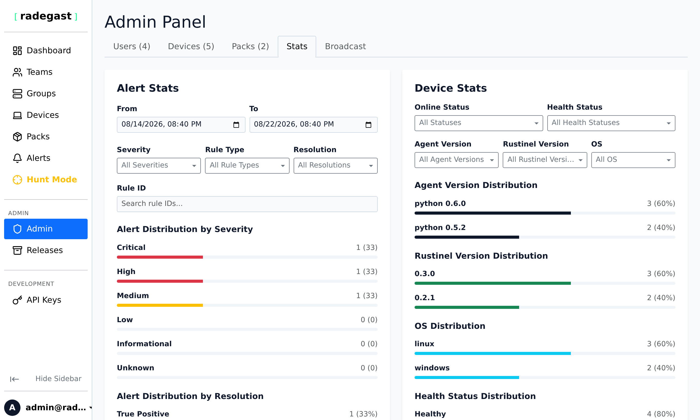
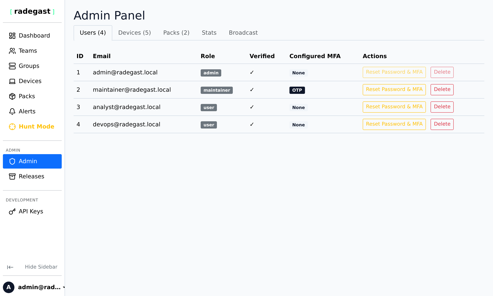
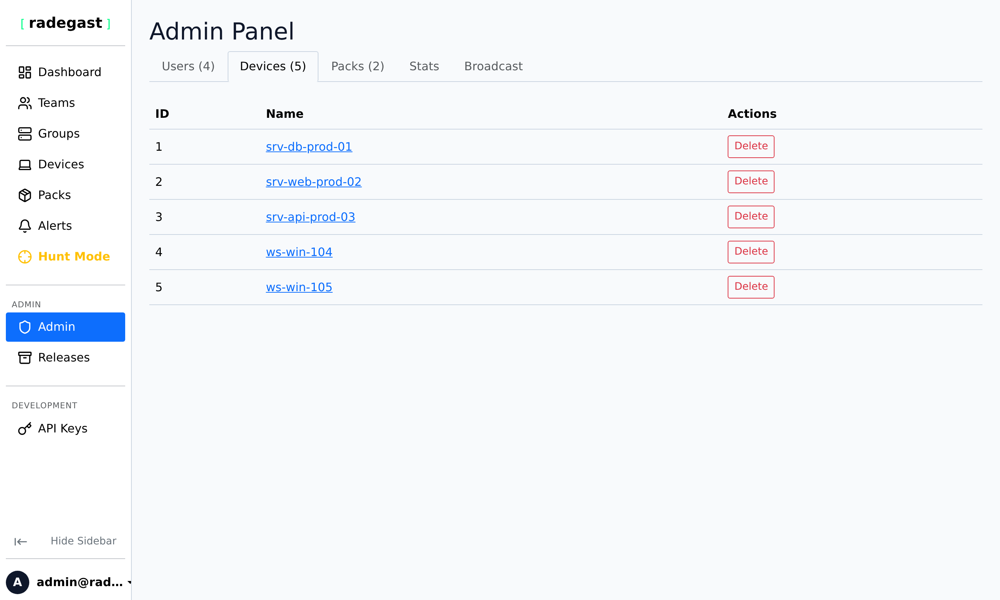
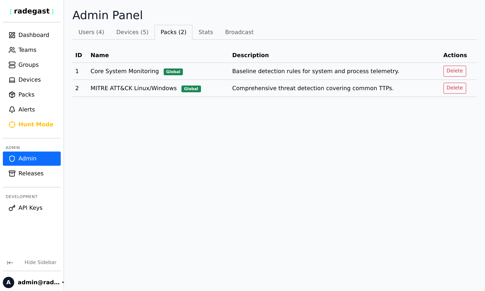
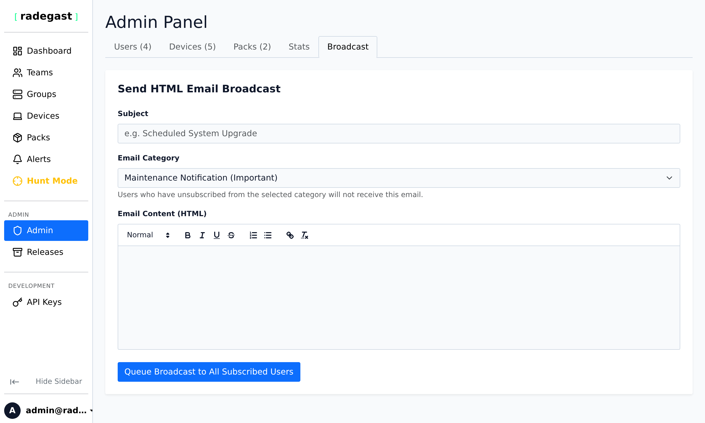

# User Administration (Admin)

## Overview

The Admin panel provides global administrative control over the Radegast EDR platform. Administrators can manage all users, endpoints, detection packs, and platform statistics across teams.

:::{note}
Only users assigned the **Admin** role can access the Admin panel.
:::

## Capabilities

- **Global User Management**: Create, inspect, modify, and delete platform user accounts.
- **System-Wide Device Control**: Inspect and delete any registered endpoint in the system.
- **Global Detection Pack Control**: Inspect, download, and delete all detection packs.
- **Credential Recovery**: Reset passwords and clear MFA configurations for locked-out users.
- **Platform Analytics**: Monitor alert distribution, device health, and telemetry volume.
- **Broadcast Announcements**: Send platform announcements by email to all registered users.

## Access the Admin Panel

1. Log in to the console with an administrator account.
2. Click **Admin** in the main navigation menu.
3. The console displays the administrative workspace.

## System Statistics (Stats)

1. In the Admin panel, click **Stats**.
2. The page displays two primary metrics views:
   - **Alert Stats**: Displays alert distribution by severity, resolution, rule ID, and rule type. You can filter by date range, severity level, rule type, and resolution status.
   - **Device Stats**: Displays endpoint distributions by agent version, Rustinel version, operating system, health status, and online status.

## User Management

### View All Users

1. In the Admin panel, click **Users**.
2. The table displays all registered users:
   - Email address.
   - Assigned role (`Admin`, `Maintainer`, or `User`).
   - Email verification status.
   - MFA setup state.
   - Storage space used.
   - Last login timestamp.

### User Roles

- **Admin**: Full administrative privileges across all platform features, users, and data.
- **Maintainer**: Can create public detection packs and manage system-level policies. Cannot manage users.
- **User**: Standard user access governed by team memberships.

### Reset a User Password

If a user loses account access:

1. Select the user from the Users list.
2. Click **Reset Password**.
3. Confirm the action.
4. The system executes these actions:
   - Generates a secure temporary password.
   - Clears existing MFA configurations (OTP keys and hardware tokens).
   - Sends the temporary password to the user by email.
   - Forces the user to create a new password and configure MFA on the next login.

### Delete a User Account

1. Select the user from the Users list.
2. Click **Delete**.
3. Confirm the deletion.
4. The system removes the user account, settings, and personal access tokens.

:::{caution}
Deleting a user account is permanent. You cannot delete your own active administrator account.
:::

## Device Management

### View All Endpoints

1. In the Admin panel, click **Devices**.
2. The list displays all endpoints enrolled in the platform across all teams.
3. The page shows the total database space consumed by all devices.

### Delete an Endpoint

1. Select the device from the list.
2. Click **Delete**.
3. Confirm the deletion.
4. The system removes the device record and telemetry data permanently.

## Detection Pack Management

1. In the Admin panel, click **Packs**.
2. The table displays all global and team-scoped detection packs.
3. To delete a pack, select the pack and click **Delete**.

:::{caution}
Deleting a detection pack removes rule files from the server. Endpoints assigned this pack stop receiving rule updates.
:::

## Send Broadcast Emails

Administrators can send platform announcements and maintenance alerts to all users:

1. In the Admin panel, click **Broadcast**.
2. Enter the email **Subject**.
3. Enter the message content in the **Body** field.
4. Click **Send Broadcast**.
5. The system queues and delivers the email to all active users.

## User Multi-Factor Authentication Status

The Users table monitors user MFA compliance:

- **MFA Required Level**: Security level mandated by the user role.
- **MFA Configured Level**: Current factor configured by the user.
- **Setup Missing**: Flags accounts that do not satisfy mandatory MFA policies.

## Troubleshooting

### Admin Menu Option Is Missing

- **Role Verification**: Verify that your account holds the Admin role. Regular users and Maintainers cannot access the Admin panel.

### Password Reset Email Does Not Arrive

- **Mail Server Configuration**: Verify that `RADEGAST_SMTP_HOST` is configured on the backend.
- **Console Logs**: If running in development mode, check server stdout for printed email bodies.

### Cannot Delete a User or Device

- **Self-Deletion**: You cannot delete the account that is currently logged in.
- **Database Locks**: If a worker process is calculating space usage, wait for the task to finish and retry.
