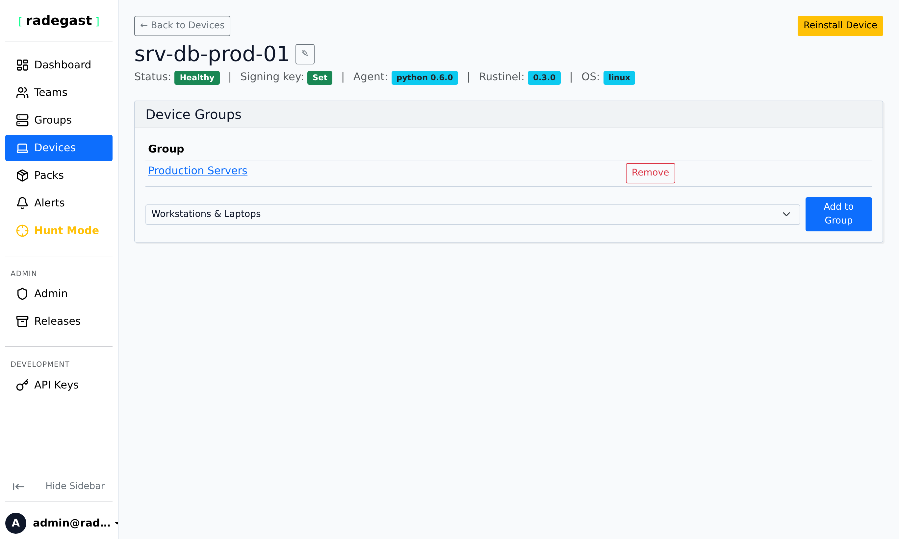

# Device Installation

## Overview

You must install the Radegast agent on each endpoint to enable security monitoring. The agent records system events, applies detection rules, and sends encrypted logs to the Radegast backend. This document provides installation instructions for Linux, Windows, and macOS endpoints.

## Prerequisites

Before you install the agent, make sure that:

1. You created a device in the Radegast Console.
2. The endpoint meets the minimum system requirements:
   - **Linux**: Kernel 4.18 or later, glibc 2.31 or later, x86_64 or ARM64.
   - **Windows**: Windows 10, Windows 11, or Windows Server 2019 or later, x86_64.
   - **macOS**: macOS 11 or later, Apple Silicon (M1/M2/M3) or Intel.
3. The endpoint can connect to the Radegast backend URL through HTTPS (port 443).
4. You have administrator or `root` permissions on the endpoint.

## Linux Installation



1. Open the Radegast Console and click **Devices**.
2. Select your device from the list.
3. Select **Linux** as the operating system.
4. Select the system architecture (**amd64** for Intel/AMD, or **arm64** for ARM).
5. Copy the installation command.
6. Run the command as `root` on your Linux endpoint.

The command executes a script that performs these tasks:
- Installs necessary dependencies.
- Downloads the latest agent from the [Releases catalog](../_static/screenshots/releases-list.png).
- Configures the agent with your device token.
- Configures and starts the `systemd` service.

## Windows Installation

1. Open the Radegast Console and click **Devices**.
2. Select your device from the list.
3. Select **Windows** as the operating system.
4. Select **amd64** as the architecture.
5. Copy the PowerShell installation command.
6. Open an elevated PowerShell prompt (Run as Administrator) on the Windows endpoint.
7. Paste and run the command.

The installation script performs these tasks:
- Downloads and installs the agent files.
- Registers the **Radegast EDR Agent** Windows service.
- Sets the service startup type to **Automatic**.
- Starts the agent service.

To verify the service manually:
1. Open Windows Services (`services.msc`).
2. Locate **Radegast EDR Agent**.
3. Make sure the service status is **Running**.

## macOS Installation

1. Open the Radegast Console and click **Devices**.
2. Select your device from the list.
3. Select **macOS** as the operating system.
4. Copy the installation command.
5. Open Terminal on the macOS endpoint and run the command as `root`.

The script performs these tasks:
- Installs an isolated Python runtime and dependencies.
- Downloads the agent and signed Rustinel binary.
- Configures the agent with your device token.
- Configures launchd daemons (`app.radegast.agent` and `io.rustinel.daemon`).
- Starts the services.

### Grant Full Disk Access on macOS

After installation, grant Full Disk Access to Rustinel:

1. Open **System Settings**.
2. Go to **Privacy & Security** and select **Full Disk Access**.
3. Enable access for `/Library/Radegast/rustinel/Rustinel.app` (or `/Library/Radegast/rustinel/rustinel`).
4. Restart the daemon:
   ```bash
   sudo launchctl kickstart -k system/io.rustinel.daemon
   ```

## Post-Installation Tasks

1. **Check Device Status**:
   - Open **Devices** in the Radegast Console.
   - Make sure the device displays an **Online** status badge.
2. **Assign Detection Packs**:
   - Assign detection packs to your device groups.
   - The agent downloads the rules on the next polling interval.

## Operational Requirements and Guidelines

- **Token Security**: Store device tokens in a secure credential manager. Do not commit tokens to public repositories.
- **File Permissions**: Restrict agent configuration file permissions to the agent user (`chmod 600`).
- **Network Access**: Endpoints must make outbound HTTPS connections on port 443 to the backend.
- **Disk Space**: Maintain at least 100 MB of free disk space for agent operations.
- **Memory Usage**: The agent typically uses 50 MB to 100 MB of RAM.

## Troubleshooting

### Agent Fails to Start

- **Examine Logs**: Check local agent log files for error messages.
- **Check Token**: Make sure the device token in the configuration file matches the console token.
- **Verify Permissions**: Make sure the agent user has read access to configuration files and write access to log directories.
- **Missing Libraries**: On Linux, make sure necessary shared libraries (such as `libssl`) are installed.

### Agent Cannot Connect to Backend

- **Verify URL**: Make sure the `backend_url` in the configuration file is correct.
- **Test Connectivity**: Run `curl -k https://<backend-url>/api/v1/health` from the endpoint.
- **Check Firewall**: Make sure outbound HTTPS connections on port 443 are allowed.
- **Check Proxy**: Configure proxy settings if the endpoint is behind an enterprise proxy.
- **Check DNS**: Make sure the endpoint can resolve the backend host name.

### Device Shows Offline in Console

- **Check Service**: Make sure the agent system service is running.
- **Synchronize Clock**: Make sure NTP synchronizes the endpoint system clock.
- **Token Invalidation**: If the device was re-registered, update the endpoint with the new token.

### Logs Do Not Appear in Console

- **Verify Online Status**: Make sure the device shows an **Online** status badge.
- **Verify Encryption Keys**: Make sure you have the corresponding private key in your browser.
- **Check Team Permissions**: Make sure your team has read permissions for the device group.
