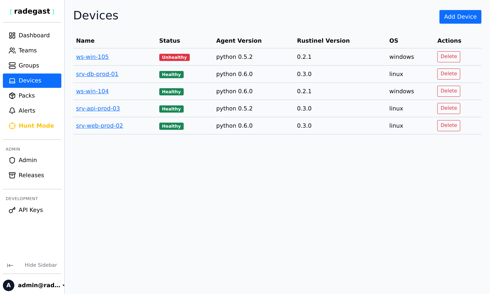
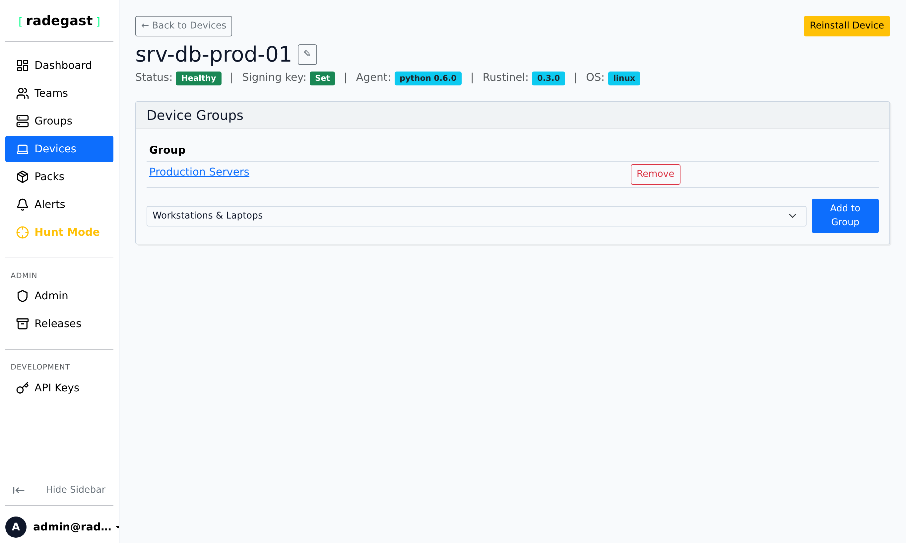

# Managing Devices

## Overview

Devices represent the endpoints that Radegast EDR monitors. Each device runs the Radegast agent. The agent collects security events and sends encrypted logs to the backend. This document describes how to add, configure, monitor, and remove devices.

## Device Capabilities

- **Endpoint Monitoring**: Monitor security events from servers, workstations, and cloud instances.
- **Centralized Control**: View and manage all devices from a single web interface.
- **Connection Status**: Track device health, online states, and last seen timestamps.
- **Token Authentication**: Authenticate each agent with a unique authorization token.
- **Group Organization**: Assign devices to groups to apply detection policies and access controls.

## View Devices

1. Log in to the Radegast Console.
2. Click **Devices** in the main navigation menu.
3. The page displays all devices that your teams have permission to view.

The device list shows:
- **Device Name**: Assigned name of the endpoint.
- **Last Seen**: Timestamp of the most recent heartbeat.
- **Agent Version**: Installed version of the Radegast agent.
- **Groups**: Groups that include this device.
- **Status**: Online or offline status indicator.
- **Actions**: Buttons to inspect details, modify settings, or remove the device.

## Add a New Device

### Prerequisites
- You must have at least one device group.
- You must belong to a team with administrative permissions for that group.

### Procedure

1. Click **Add Device** on the Devices page.
2. In the dialog:
   - Enter a descriptive **Device Name** (for example, `srv-web-01`).
   - Select a **Device Group**.
3. Click **Create Device**.
4. The dialog displays the **Device Token**.
   - Copy and save this token in a secure password manager.
   - You need this token to configure the agent on the endpoint.
   - The console does not display this token again after you close the dialog.
5. Click **Done** to close the dialog.

To install the agent, refer to the [Device Installation Guide](device-installation.md).

## View Device Details

1. Click a device name in the list.
2. The details panel displays:
   - Device identifier and creation date.
   - **Last Seen**: Timestamp of the latest connection.
   - **Agent Version**: Running version of the agent software.
   - **Signature Public Key**: Public key used to verify agent telemetry.
   - **Assigned Groups**: Groups that contain this endpoint.
   - **Authorization Token**: Date when the token was last generated.

## Modify a Device

### Rename a Device

1. Select the device from the list.
2. Click **Edit**.
3. Enter the new name.
4. Click **Save**.

### Modify Device Group Assignments

1. Select the device from the list.
2. Locate the **Groups** section in the details panel.
3. Click **Manage Groups**.
4. Select or deselect groups.
5. Click **Save**.

:::{note}
An endpoint must belong to at least one group. You cannot remove a device from all groups.
:::

## Regenerate a Device Token

If you lose a device token or reinstall the agent software:

1. Select the device from the list.
2. Click **Reinstall** or **Regenerate Token**.
3. Confirm the action.
4. The system generates a new token and invalidates the previous token.
5. Copy the new token and update the agent configuration file on the endpoint.
6. Restart the agent service.

## Delete a Device

1. Select the device from the list.
2. Click **Delete**.
3. Confirm the deletion.
4. The system removes the device and its database records.

:::{caution}
Deleting a device is permanent. If you delete a device, you must register and enroll the device again to resume monitoring.
:::

## Guidelines and Best Practices

- **Naming Conventions**: Use structured names (for example, `prod-db-01` or `corp-laptop-04`) to identify systems quickly.
- **Group Structure**: Organize devices by role (such as web servers, database clusters, or developer workstations).
- **Multiple Groups**: Assign a device to multiple groups to grant access to multiple teams or apply layered detection packs.
- **Credential Storage**: Protect device tokens. Never store tokens in unencrypted plain text.

## Troubleshooting

### Device Shows Offline

- **Check Agent Process**: Make sure the agent service is active on the endpoint.
- **Check Network Route**: Make sure the endpoint can connect to the console backend URL.
- **Clock Drift**: Synchronize system time with NTP. Large time offsets cause authentication failures.
- **Firewall Policy**: Make sure outbound connections to port 443 are open.

### Cannot Add a Device

- **No Groups Found**: Create a device group before you add devices.
- **Insufficient Permissions**: Make sure your team has admin permissions on the target group.
- **Validation Errors**: Fill in all required fields.

### Device Token Rejected

- **Token Expired**: If you regenerated the token, make sure you configured the newest token on the endpoint.
- **Whitespace**: Make sure you copied the token string without leading or trailing spaces.
