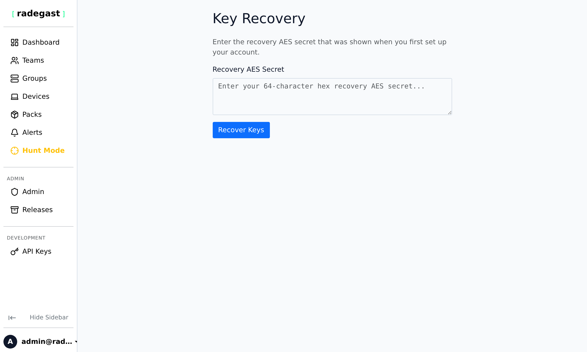
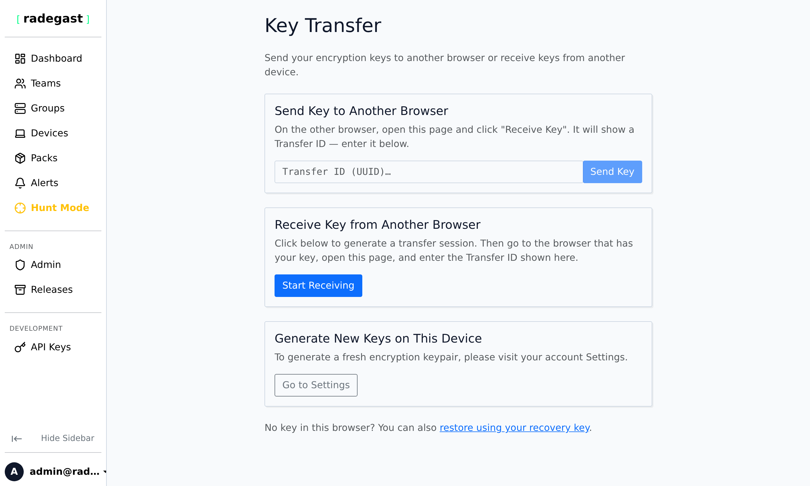

# Encryption Keys

## Overview

Encryption Keys form the core of the privacy model in Radegast EDR. Agents encrypt all event logs with the age encryption format before transmission. Only users with the matching private key can decrypt and inspect telemetry. This architecture enforces end-to-end encryption across the platform.

## Cryptographic Model

Radegast EDR implements public-key cryptography using age (X25519 and ChaCha20-Poly1305):

- **Public Key**: The server stores your public key and distributes it to your enrolled devices. Devices use this key to encrypt log records.
- **Private Key**: The browser generates and stores your private key in local storage. The browser never transmits private keys to the server.
- **Recovery Key**: A 256-bit AES key used to encrypt a backup of your private key on the server.
- **Encryption Workflow**:
  1. The agent encrypts telemetry with your public key.
  2. The agent sends encrypted records to the backend.
  3. The browser fetches encrypted records and decrypts them locally using your private key.

## View Encryption Keys

1. Log in to the Radegast Console.
2. Go to **Settings > Encryption Keys**.
3. The page displays all configured key pairs.

The keys table displays:
- **Name**: Assigned name of the key pair.
- **Public Key**: Full public key string.
- **Created**: Generation timestamp.
- **Active**: Indicates if this key encrypts logs for newly created devices.
- **Default**: Indicates if the browser tries this key first for decryption.
- **Actions**: Buttons to set active status, export, or delete the key.

## Create an Encryption Key Pair

### Initial Setup for New Accounts

When you log in to a new account, the console prompts you to initialize encryption keys:

1. Go to **Settings > Encryption Keys**.
2. Click **Generate Key Pair**.
3. Enter a descriptive **Name** (for example, `Work Laptop Key`).
4. Select the **Generate Recovery Key** checkbox.
5. Click **Generate & Register**.
6. The dialog displays your **256-bit AES Recovery Key** (64 hexadecimal characters).
   - Copy this key and save it in a password manager immediately.
   - The console does not display this recovery key again.
7. Confirm that you saved the recovery key.
8. Click **Done**.

### Add an Additional Key Pair

1. Go to **Settings > Encryption Keys**.
2. Click **Add Key**.
3. Enter a descriptive name.
4. Choose whether to make this key the active key for new devices.
5. Click **Create**.

## Manage Key States

### Set an Active Key

Only one key pair can be active at a time. The system assigns the active public key to newly enrolled devices:

1. Select the key pair from the list.
2. Click **Set as Active**.
3. Confirm the action.

:::{note}
Existing devices continue to use their previously assigned public key until reconfigured.
:::

### Set a Default Decryption Key

1. Select the key pair from the list.
2. Click **Set as Default**.
3. The browser tries this private key first when decrypting log records.

## Key Recovery Options

If you clear your browser storage or use a new device, use one of these recovery procedures:

### Option 1: Restore with a Recovery Key

1. Click **Keys > Recovery** in the navigation menu.
2. Enter your 64-character hexadecimal **Recovery Key**.
3. Click **Restore Key**.
4. The system decrypts the backup private key and stores it in your browser local storage.

### Option 2: Transfer Key from Another Browser

If an existing browser session still holds your private key:

1. In the source browser, go to **Settings > Encryption Keys > Transfer**.
2. Click **Generate Transfer Token**.
3. Copy the ephemeral transfer token.
4. In the target browser, go to **Keys > Transfer**.
5. Paste the transfer token.
6. Click **Import Key**. The browser imports and stores the private key securely.

:::{note}
Transfer tokens expire within 10 minutes and work only once.
:::

## Delete a Key Pair

1. Select the key pair from the list.
2. Click **Delete**.
3. Review the warning prompt.
4. Confirm the deletion.

:::{caution}
Deleting a key pair is irreversible. You cannot decrypt logs encrypted with this key unless you have an offline backup. You cannot delete your only remaining key pair.
:::

## Security Guidelines

- **Local Storage Isolation**: Private keys remain inside browser local storage. Private keys never sync automatically between different browsers.
- **Recovery Key Storage**: Store your 64-character recovery key in a password manager. If you lose your recovery key, you cannot recover encrypted logs.
- **Private Browsing**: Do not perform operational triage in incognito mode if your browser blocks local storage.

## Troubleshooting

### Private Key Not Found Error

- **Cleared Storage**: Browser cache or local storage was cleared. Use your recovery key to restore the private key.
- **New Browser**: Use the Key Transfer feature to copy keys from your primary browser.

### Recovery Key Fails to Restore

- **Invalid Format**: Verify that the recovery key contains exactly 64 hexadecimal characters (`0-9`, `a-f`).
- **Wrong Key**: Verify that the recovery key corresponds to the selected key pair.
