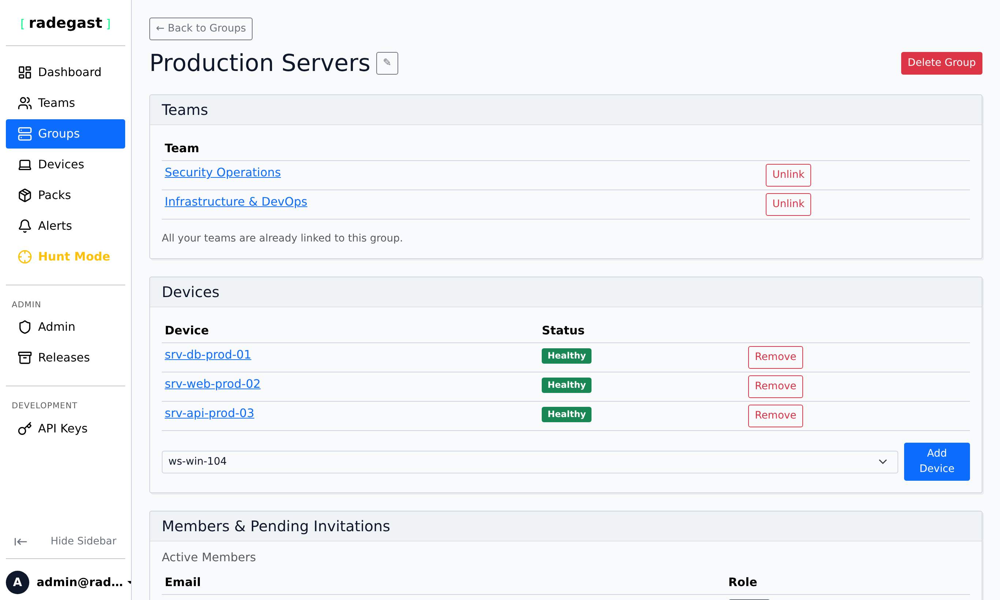

# Exclusions

## Overview

Exclusions filter known benign events to reduce alert noise and false positives. You write exclusion expressions with JSONata syntax to match and suppress specific event patterns. This document explains how to configure, test, and manage exclusions.

## Exclusion Types (Extended EDR Mode)

When you enable Extended EDR mode, you can select between two exclusion behaviors:

- **Hard Exclusion** (Default): The agent suppresses matching events completely. The agent never sends these events to the console database.
- **Soft Exclusion**: The agent sends matching events to the console database. The system downgrades their severity to `informational` and marks them with an `Excluded` badge. This keeps the events searchable in Hunt Mode without creating alert noise.

## Exclusions Compared to the Prevention Allowlist

Do not confuse Detection Exclusions with the **[Prevention Allowlist](groups.md#prevention-allowlist)**:

- **Detection Exclusions**: Modify alert generation with JSONata queries. Hard exclusions drop alerts. Soft exclusions downgrade alerts to informational.
- **Prevention Allowlists**: Modify automated process termination in Active Response. The system continues to generate alerts, but the agent does not kill the process.

:::{tip}
If you want to prevent Active Response from killing a critical service without hiding alerts, configure a **[Prevention Allowlist](groups.md#prevention-allowlist)** entry instead of an exclusion.
:::

## View Exclusions

1. Log in to the Radegast Console.
2. Click **Exclusions** in the main navigation menu, or open a specific device group.
3. The page displays all active exclusion rules.

The exclusions table displays:
- **Name**: Name of the exclusion rule.
- **Device Group**: Group that applies this exclusion.
- **Description**: Explanation of the filtered behavior.
- **Query**: JSONata expression that matches events.
- **Actions**: Buttons to inspect details, edit, or delete the exclusion.

## Create an Exclusion



1. Go to **Exclusions** and click **Create Exclusion**.
2. Complete the form:
   - **Device Group**: Select the target group. The rule applies only to endpoints in this group.
   - **Name**: Enter a descriptive name (for example, `Ignore Nightly Backup Scans`).
   - **Description**: Explain why this exclusion is necessary.
   - **JSONata Query**: Enter the JSONata query that matches target events.
   - **Exclusion Type** (Extended EDR mode): Select **Hard Exclusion** or **Soft Exclusion**.
3. Click **Create Exclusion**.

:::{note}
You must have pack write permissions on the teams that own the device group.
:::

## JSONata Query Patterns

JSONata evaluates JSON event data. Use these common query patterns:

### Exact Value Matching

```javascript
// Exclude events where process_name equals "backup-agent"
process_name = "backup-agent"

// Exclude events from a specific service user
user = "service-account"

// Exclude events with informational severity
severity = "informational"
```

### Pattern and String Functions

```javascript
// Exclude events where process_name contains "scan"
$contains(process_name, "scan")

// Exclude events where the path starts with "/tmp/"
$startsWith(path, "/tmp/")

// Exclude events matching a regular expression
$match(process_name, /^backup-/)
```

### Compound Conditions

```javascript
// Exclude events matching user AND directory path
user = "backup" and $contains(path, "/var/log/")

// Exclude events matching any process in an array
process_name in ["backup", "monitoring", "cron"]
```

### Nested Field References

```javascript
// Exclude based on a nested event attribute
event.details.action = "read"
```

## Test an Exclusion Query

Test your query before saving:

1. Click **Test Query** in the exclusion form.
2. The preview displays recent events that match your expression.
3. Verify that the query matches only expected benign events.
4. Adjust the query if unexpected events match.

## Edit an Exclusion

1. Select the exclusion from the list.
2. Click **Edit**.
3. Modify the name, description, or JSONata query expression.
4. Click **Save Changes**.

## Delete an Exclusion

1. Select the exclusion from the list.
2. Click **Delete**.
3. Confirm the deletion.
4. The system removes the exclusion immediately. Endpoints resume processing matching events.

## Troubleshooting

### Cannot Create an Exclusion

- **Syntax Error**: Validate your JSONata expression syntax.
- **Permissions**: Make sure you have pack write permissions on the device group's managing teams.
- **Missing Fields**: Complete all required fields in the form.

### Exclusion Does Not Filter Events

- **Wrong Group**: Verify that the affected endpoint belongs to the group where the exclusion is defined.
- **Case Sensitivity**: JSONata expressions are case-sensitive. Use `$lowercase(process_name)` for case-insensitive comparisons.
- **Event Schema**: Inspect the raw event JSON to make sure field names match your query.
