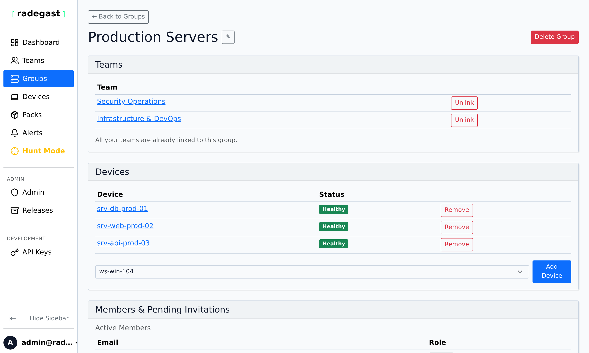

# Exclusions

## Feature Overview

Exclusions allow you to filter out specific security events that you know are safe or expected, reducing alert fatigue and false positives. Using JSONata query expressions, you can define precise patterns to exclude from triggering alerts, helping your team focus on genuine security threats.

### Hard vs. Soft Exclusions (Extended EDR Only)

When Extended EDR is enabled, you can choose between two different exclusion behaviors:

- **Hard Exclusion** (Default): The agent filters matching events completely. These events are never sent to the console database, preventing any console visibility.
- **Soft Exclusion**: The events are still sent to the console database, but their severity is automatically downgraded to `informational`, and they are visually marked with an `Excluded` badge in the threat triage view. This preserves visibility and queryability of these events for threat hunting without causing alert fatigue.

### Exclusions vs. Prevention Allowlist

It is important to distinguish between **Detection Exclusions** and the **[Prevention Allowlist](groups.md#prevention-allowlist)**:

- **Detection Exclusions** (this guide) modify the *alerting pipeline* using JSONata queries. They determine whether an alert is generated and sent to the console (Hard Exclusion silences the alert; Soft Exclusion downgrades it to informational).
- **Prevention Allowlists** modify the *prevention pipeline* of Active Response. They exempt specific path prefixes or process images (such as `sshd` or databases) from being terminated while **preserving full alert generation and console visibility**.

:::{tip}
If your goal is to stop Active Response from killing a critical daemon without blinding your team to potential abuse of that daemon, configure a **[Prevention Allowlist](groups.md#prevention-allowlist)** entry on the Device Group rather than an exclusion.
:::

## What Value Does This Feature Add?

- **False Positive Reduction**: Eliminate known-safe events from your alerts
- **Custom Filtering**: Create precise exclusion rules using JSONata query syntax
- **Group-Specific**: Apply different exclusions to different device groups
- **Reusable**: Define an exclusion once and apply it to as many device groups as you need
- **Improved Signal-to-Noise**: Focus your team's attention on real threats
- **Flexible Rules**: Define exclusions based on any field in the event data

## Step-by-Step Guide

### Accessing Exclusions

1. Log in to your Radegast Console
2. Click **"Exclusions"** in the main navigation menu
3. The Exclusions page will display all exclusion rules you have permission to view

**Alternative Access**: You can also manage exclusions from within a specific device group's details page.

### Understanding the Exclusions List

The Exclusions page lists every exclusion once, even when it is applied to several device groups:

- **Name** and **Description**: What the exclusion does and why it exists
- **Device Groups**: The groups the exclusion is applied to. Groups you do not have access to are shown as a count (for example `+2 other`)
- **Type**: Hard or soft exclusion
- **JSONata Query**: The expression that defines the exclusion pattern
- **Source Alert**: The alert the exclusion was created from, if any
- **Last Change**: What was last changed (created, edited, applied to or removed from a group), by whom and when
- **Actions**: Apply to another group, edit, or delete the exclusion

### Creating a New Exclusion



#### Steps

1. Navigate to the Exclusions page or to a specific device group
2. Click **"Create Exclusion"** or **"Add Exclusion"**
3. In the creation form:
   - **Device Groups**: Select one or more device groups this exclusion applies to
     - The exclusion only affects devices in the selected groups
     - When created from a device group's page, it is applied to that group
   - **Name**: Enter a descriptive name (e.g., "Ignore Scheduled Scans", "Allow Development Tools")
   - **Description**: Explain what events this exclusion filters out
   - **JSONata Query**: Enter the JSONata expression that matches events to exclude
   - **Exclusion Type** (Extended EDR only): Select the exclusion behavior from the dropdown:
     - **Hard Exclusion**: Completely filter out matching events on the agent.
     - **Soft Exclusion**: Downgrade matching events to informational severity.
4. Click **"Create Exclusion"**

**Note**: You need pack write permissions on every selected device group to create exclusions.

### JSONata Query Basics

JSONata is a powerful query language for JSON data. Here are some common patterns for exclusions:

#### Simple Field Matching
```javascript
// Exclude events where process_name equals "backup-agent"
process_name = "backup-agent"

// Exclude events from specific user
user = "service-account"

// Exclude events with specific severity
severity = "informational"
```

#### Pattern Matching
```javascript
// Exclude events where process_name contains "scan"
$contains(process_name, "scan")

// Exclude events where path starts with "/tmp/"
$startsWith(path, "/tmp/")

// Exclude events matching a regex pattern
$match(process_name, /^backup-/)
```

#### Multiple Conditions
```javascript
// Exclude events where user is "backup" AND path contains "/var/"
user = "backup" and $contains(path, "/var/")

// Exclude events where process is in a list of known-safe processes
process_name ~> ["backup", "monitoring", "cron"]

// Exclude events with multiple severity levels
severity ~> ["informational", "low"]
```

#### Nested Field Access
```javascript
// Exclude based on nested field
event.details.action = "read"

// Exclude based on array contents
$some(settings.permissions, permission = "admin")
```

### Testing Your Query

Before saving an exclusion, test it to ensure it matches what you expect:

1. In the exclusion creation form, look for a **"Test Query"** or **"Preview"** button
2. This will show you recent events that would be excluded by your query
3. Verify that only the intended events are matched
4. Adjust your query if needed

### Viewing Exclusion Details

1. Click on an exclusion in the list
2. The details panel shows:
   - Complete JSONata query
   - Which device group it applies to
   - Creation timestamp
   - All matching criteria
   - Option to test the query against recent events

### Applying an Exclusion to More Device Groups

An exclusion can be reused in several device groups. Changes to it apply to every group it is applied to.

1. On the **Exclusions** page, click the **+** (Apply to another group) button of the exclusion
2. Select the device group
3. Click **"Apply"**

Alternatively, open a device group, click **"Apply Existing"** in the Exclusions section and select one of the exclusions from your other groups.

**Note**: You need pack write permission on the target device group.

### Removing an Exclusion from a Device Group

- On the **Exclusions** page, click the **x** next to the group name, or
- On the device group page, click **x** next to a shared exclusion (**"Remove from this group"**)

The exclusion stays applied to its other groups. Removing an exclusion from its **last** group deletes it.

**Note**: You need pack write permission on the device group you remove it from.

### Editing an Exclusion

1. Click the edit icon of the exclusion
2. Modify any of these fields:
   - Name
   - Description
   - JSONata query
   - Exclusion type
3. Click **"Update Exclusion"**

The change applies to **every** device group the exclusion is applied to, and the exclusion keeps its identity, so alerts that were excluded by it stay linked to it.

**Note**: Editing requires pack write permission on **all** device groups the exclusion is applied to. This prevents a team from changing the behavior of devices in groups it does not control. If you only control some of the groups, you can still remove the exclusion from your groups and create your own version.

**Tip**: Always test your edited query before saving to ensure it still works as expected.

If someone else changed the exclusion while you were editing it, saving fails with a message asking you to reload; the list is refreshed so you can re-apply your change.

### Deleting an Exclusion

1. Click the delete icon of the exclusion on the **Exclusions** page
2. Confirm the deletion
3. The exclusion is removed from **all** device groups and no longer filters events

**Note**: Deleting requires pack write permission on all device groups the exclusion is applied to.

### Last Change

Every exclusion shows its most recent change: whether it was created, edited, applied to a group or removed from a group, which user made the change and when. Exclusions created before this feature existed are shown as *Created before change tracking*.

### Encryption of Exclusions

When end-to-end encryption is available, the name, query and description of an exclusion are encrypted in your browser for the key of **every device group it is applied to**. Only members and devices of those groups can read it; the server only stores the encrypted value.

- An exclusion is encrypted when all selected groups have encryption keys set up and all their agents run **python 0.5.0** or newer. Otherwise it is stored unencrypted and marked **Unencrypted**.
- An encrypted exclusion can only be applied to groups that meet the same requirements.
- When an encrypted exclusion is applied to or removed from a group, your browser re-encrypts it for the new set of groups, so a removed group can no longer read it.

### Bulk Exclusion Management

You can manage exclusions for a specific device group:

1. Go to **Groups** page
2. Click on the device group
3. Scroll to the **Exclusions** section
4. Here you can:
   - View all exclusions for this group
   - Create new exclusions specifically for this group
   - Edit or delete existing exclusions

## Tips & Validations

- **Query Syntax**: JSONata queries must be valid. Invalid queries will be rejected.
- **Group Scope**: Exclusions only apply to the device groups they're applied to.
- **Order of Operations**: Exclusions are applied before alerts are generated, not after.
- **Performance**: Complex queries may impact agent performance. Keep queries as simple as possible.
- **Security**: Be careful not to exclude legitimate security events. Review exclusion patterns regularly.
- **Audit**: Maintain documentation of why each exclusion exists.

**Tip**: Start with broad exclusions for known-safe categories, then add more specific ones as needed.

**Tip**: Use the description field to document WHY the exclusion exists (e.g., "Ignore nightly backup process - generates false positives").

**Tip**: Test exclusions during low-traffic periods first to ensure they work as expected.

**Tip**: Review your exclusions periodically to ensure they're still appropriate.

**Tip**: Consider creating a "Default Exclusions" group that all new devices are added to, containing common false positive patterns.

## Troubleshooting

### Can't create an exclusion

- **Permission denied**: You need pack write permissions on every selected device group
- **Invalid query**: The JSONata query may have syntax errors
- **Missing group**: You may not have selected a device group
- **Form validation**: All required fields (group, name, query) must be filled

### Can't edit an exclusion

- **Shared with other groups**: Editing requires pack write permission on all groups the exclusion is applied to. Groups you cannot access are shown as `+N other`
- **Changed by someone else**: Reload the page and apply your change again

### Exclusion not working

- **Wrong group**: The exclusion may be applied to a different group than the device
- **Query error**: The JSONata query may not match the expected event format
- **Syntax error**: Check the query for syntax errors
- **Case sensitivity**: JSONata is case-sensitive by default. Use $lowercase() or $uppercase() if needed.
- **Event structure**: The event fields may be different than you expect. Test with real event data.

### Can't see any exclusions

- **No exclusions**: Your organization may not have any exclusions created yet
- **Permission issue**: You need pack read permissions on teams that own device groups with exclusions
- **Group access**: You may not have access to any device groups with exclusions

### Can't delete an exclusion

- **Permission denied**: Deleting requires pack write permissions on all of the exclusion's device groups. You can still remove it from your own groups
- **Exclusion not found**: The exclusion may have already been deleted
- **Group access**: You may not have access to the device group the exclusion belongs to

### Too many events being excluded

- **Query too broad**: The exclusion query may be matching more than intended
- **Test first**: Always test queries before saving to see what they match
- **Start specific**: Start with very specific queries and broaden as needed
- **Review regularly**: Check exclusion statistics to see how many events are being filtered

### Events that should be excluded aren't

- **Wrong group**: The device may not be in the group with the exclusion
- **Query mismatch**: The event data may not match your query structure
- **Timing**: The exclusion may have been created after the events were already processed
- **Syntax**: There may be a subtle syntax issue in your query
