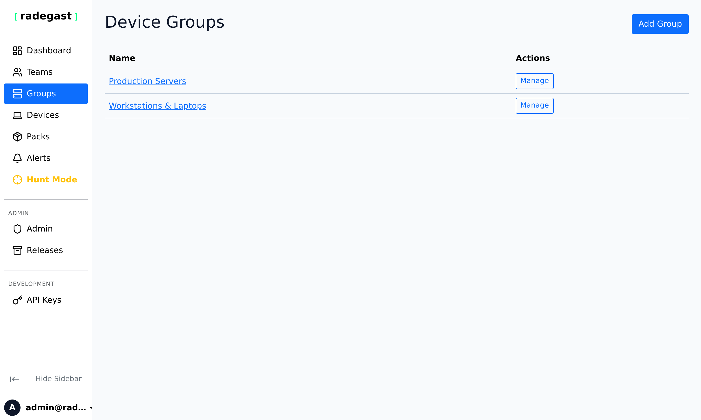
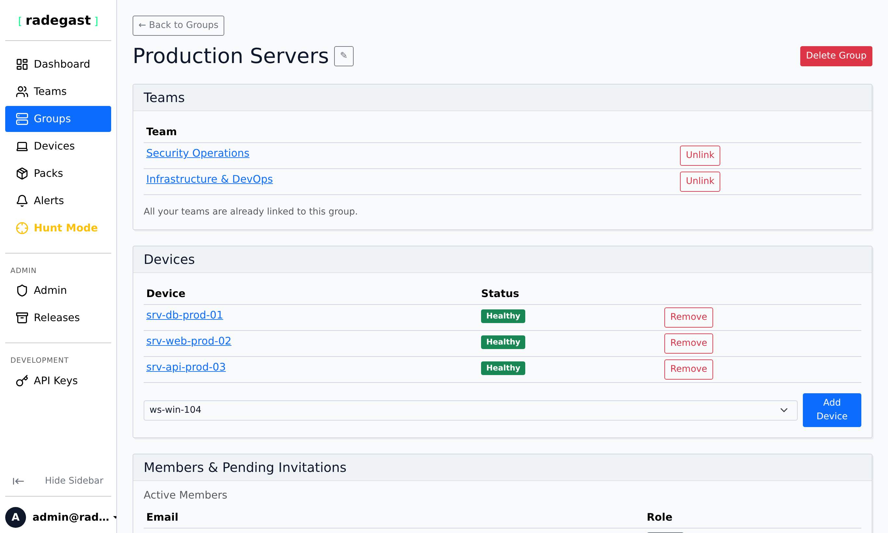

# Device Groups

## Overview

Device Groups collect endpoints that share detection policies, exclusions, and access permissions. You can organize endpoints logically and apply consistent rules across multiple systems. This guide describes how to create, configure, and manage device groups.

## Capabilities

- **Logical Grouping**: Group endpoints by environment, function, operating system, or department.
- **Policy Enforcement**: Apply detection packs and JSONata exclusions to collections of endpoints.
- **Access Control**: Delegate group access to specific teams.
- **Automated Prevention**: Configure Active Response process termination rules and Prevention Allowlists.

## View Device Groups

1. Log in to the Radegast Console.
2. Click **Groups** in the main navigation menu.
3. The page displays all device groups that you have permission to view.

The groups table displays:
- **Group Name**: Name of the group.
- **Device Count**: Number of assigned endpoints.
- **Team Count**: Number of teams that manage the group.
- **Exclusion Count**: Number of active exclusions.
- **Space Used**: Total database storage consumed by endpoints in this group.
- **Actions**: Buttons to view details, edit, or delete the group.

## Create a Device Group

1. Click **Create Group** on the Groups page.
2. Enter a descriptive **Group Name** (for example, `Production Web Servers`).
3. Select one or more **Teams** to own this group. Teams that own a group can access all devices in that group.
4. Click **Create Group**.

:::{note}
You must belong to at least one team with administrative write permissions (`admin=write`) to create a group.
:::

## View Group Details

1. Click a group name in the list.
2. The details page displays:
   - Group name and creation date.
   - **Teams**: Teams that own and manage the group.
   - **Devices**: Endpoints assigned to the group.
   - **Exclusions**: JSONata exclusions active on this group.
   - **Detection Packs**: Packs enabled for devices in this group.
   - **Active Response Settings**: Automated process termination configuration.
   - **Prevention Allowlist**: Processes shielded from automated termination.

## Manage Group Devices

### Add Devices to a Group

1. Open the group details page.
2. Locate the **Devices** section and click **Add Device**.
3. Select the devices from the list.
4. Click **Add**.

### Remove Devices from a Group

1. Open the group details page.
2. Locate the device in the **Devices** table.
3. Click the **Remove** button.
4. Confirm the removal.

:::{note}
An endpoint must belong to at least one group. You cannot remove an endpoint from its only group.
:::

## Manage Group Ownership

Multiple teams can manage a group. This lets different operational teams share access to endpoints.

### Add a Team to a Group

1. Open the group details page.
2. Locate the **Teams** section and click **Add Team**.
3. Select the team from the dropdown list.
4. Click **Add**.

### Remove a Team from a Group

1. Open the group details page.
2. Locate the team in the **Teams** table.
3. Click the **Remove** button.
4. Confirm the removal.

:::{caution}
Every group must have at least one managing team. You cannot remove the last remaining team.
:::

## Delete a Device Group

1. Remove or reassign all devices in the group to other groups.
2. Open the group details page.
3. Click **Delete Group**.
4. Confirm the deletion.

:::{caution}
You cannot undo group deletion. You cannot delete a group that still contains devices.
:::

## Active Response Settings

Active Response terminates processes that trigger high-severity detection rules automatically.

:::{note}
Active Response controls appear only when you enable **Extended EDR Features** in your user [Settings](settings.md).
:::

:::{caution}
Active Response requires Radegast EDR Agent version **0.6.0** or later. If an endpoint runs an older agent version, the console displays a warning alert and Active Response stays inactive for that endpoint.
:::

### Configure Active Response

1. Go to **Settings** and enable **Extended EDR Features**.
2. Go to **Groups** and select your target group.
3. Locate **Active Response Settings**.
4. Select the **Enable Active Response** checkbox.
5. Select the **Minimum severity level for termination** (`Low`, `Medium`, `High`, or `Critical`).
6. Review the warning dialog and confirm your choice. Make sure you have no active false positives at the selected severity level.

### Multi-Group Severity Resolution

If an endpoint belongs to multiple groups with Active Response enabled, the agent selects the lowest severity threshold among those groups. For example, if Group A specifies `Critical` and Group B specifies `High`, the agent terminates processes matching `High` and `Critical` events.

## Prevention Allowlist

The Prevention Allowlist defines processes and directory paths that the agent must never terminate, even if they trigger detection rules.

### Purpose of the Prevention Allowlist

Automated process termination can disrupt critical infrastructure if a rule triggers on a legitimate service. The Prevention Allowlist protects critical operations:

1. **Prevents Service Outages**: Protects critical daemons (such as `postgres`, `mysqld`, `nginx`, and `containerd`) from accidental termination.
2. **Prevents Administrator Lockout**: Protects remote access daemons (`sshd`, remote management agents) so administrators maintain connectivity.
3. **Preserves Threat Visibility**: Rules continue to trigger and generate alerts in the console. Only process termination is suppressed.
4. **Group-Scoped Granularity**: Different groups enforce different allowlists based on their workload.
5. **End-to-End Encryption**: The browser encrypts allowlist entries with the group's age public key before saving them to the backend.

### Prevention Allowlists Compared to Detection Exclusions

| Attribute | Detection Exclusions | Prevention Allowlist |
|:---|:---|:---|
| **Primary Goal** | Filter false positive alerts | Exempt trusted processes from termination |
| **Response Effect** | Suppresses alerts so no termination triggers | Bypasses termination directly |
| **Console Visibility** | Suppressed (Hard) or downgraded (Soft) | Full visibility with original severity |
| **Format** | JSONata query expression | Directory path prefix or process image name |
| **Threat Hunting** | Hidden or deprioritized | Fully indexed and searchable in Hunt Mode |
| **Best Used For** | Repetitive benign scripts | Critical daemons, databases, and administrative tools |

### Entry Types

- **Path Prefix (`path`)**: The agent does not terminate processes that execute from this directory path prefix.
  - Linux examples: `/usr/local/bin/`, `/opt/company/`
  - Windows examples: `C:\Program Files\Datadog\`, `C:\Windows\System32\`
  :::{tip}
  End path prefixes with a trailing slash (`/` on Linux and macOS, `\` on Windows) to prevent partial name matches.
  :::
- **Image Name (`image`)**: The agent does not terminate processes matching this exact binary name, regardless of path.
  - Linux examples: `sshd`, `dockerd`, `systemd`
  - Windows examples: `svchost.exe`, `lsass.exe`, `services.exe`

### Add an Allowlist Entry

1. Make sure you have **Pack Write** permissions on a team that owns the group.
2. In the console, select the target group under **Groups**.
3. Locate the **Prevention Allowlist** card.
4. Click **Add Entry**.
5. Select the entry type: **Path Prefix** or **Image Name**.
6. Enter the value and an optional explanation.
7. Click **Add Entry**. The browser encrypts the data before transmission.

### Delete an Allowlist Entry

1. Locate the entry in the **Prevention Allowlist** table.
2. Click the red trash icon.
3. Confirm the deletion. The agent updates its policy during the next synchronization interval.

### Multi-Group Resolution for Allowlists

When an endpoint belongs to multiple groups, the agent combines allowlists from all assigned groups. If an entry matches an allowlist in any assigned group, the agent does not terminate the process.

## Troubleshooting

### Cannot Create a Group

- **Permissions**: Make sure you have administrative write permissions on at least one team.
- **Required Fields**: Enter a unique group name and select at least one managing team.

### Cannot Remove an Endpoint

- **Single Group Membership**: An endpoint must remain in at least one group. Assign a new group before removing the existing group.

### Cannot Delete a Group

- **Assigned Endpoints**: Move all endpoints out of the group before deleting it.
