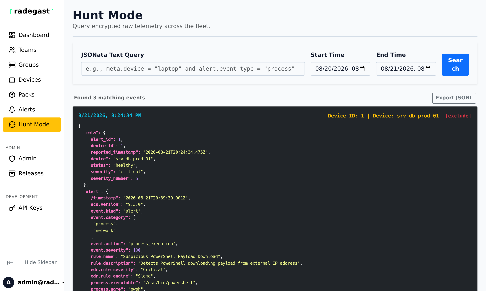

# Hunt Mode

## Overview

Hunt Mode queries encrypted raw telemetry across your entire fleet of endpoints. Security analysts use Hunt Mode to investigate historical events, identify threat patterns, and find suspicious activity across devices.

:::{note}
Hunt Mode requires **Extended EDR mode** enabled in your user settings.
:::

## Capabilities

- **Fleet-Wide Queries**: Search telemetry across all monitored endpoints simultaneously.
- **JSONata Syntax**: Filter and project structured event records using JSONata expressions.
- **Raw Telemetry**: Query complete, unredacted security events stored in the backend.
- **Time-Bounded Investigation**: Search historical event streams within custom date and time ranges.

## Prerequisites

Before you use Hunt Mode, make sure that:
1. You enabled **Extended EDR mode** in your user settings.
2. Your browser contains your age private key to decrypt telemetry.
3. Your teams hold `logs=read` permissions for the target endpoints.

## Access Hunt Mode

1. Log in to the Radegast Console.
2. Click **Hunt** in the main navigation menu.
3. If Extended EDR mode is disabled, the console prompts you to enable it in Settings.



The Hunt interface includes:
- **JSONata Query Input**: Text field for your query expression.
- **Start Time and End Time**: Date and time selectors to set your search window.
- **Search and Stop Button**: Run a query or stop an active search.
- **Search Progress**: Shows fetched pages, event count, and timestamp ranges.
- **Results Table**: Displays matching events as the browser fetches and decrypts them.

## Run a Hunt Query

1. **Set the Time Window**:
   - Click the calendar selectors for **Start Time** and **End Time**.
   - Select the target date and time range (default is the last 15 minutes).
2. **Enter the JSONata Query**:
   ```javascript
   meta.device = "laptop" and alert.event_type = "process"
   ```
   This query finds process events from devices containing "laptop" in their name.
3. **Execute the Query**:
   - Click **Search**.
   - The browser streams and decrypts matching records dynamically.
   - Click **Stop** to halt further fetching while keeping retrieved events.

## Common Query Examples

| Query | Description |
|:---|:---|
| `severity = "critical"` | Find all critical events. |
| `meta.device ~> /server/` | Find events from devices containing "server" in their name. |
| `alert.event_type = "network"` | Find all network-related events. |
| `$exists(alert.file_name)` | Find events that contain a `file_name` property. |
| `alert.pid > 1000` | Find processes with a Process ID greater than 1000. |
| `meta.device = "srv-01" and severity in ["high", "critical"]` | Find high or critical alerts on device `srv-01`. |

## View Query Results

1. Inspect matching events in the results table.
2. The results table displays:
   - Event timestamp.
   - Device name.
   - Event summary and type.
   - Severity level.
3. Click an event row to inspect the complete decrypted JSON payload.

## Decrypt Hunt Data

The agent encrypts telemetry client-side before transmission:
- The browser decrypts matching events automatically using your local age private key.
- If a private key is missing, the event displays as encrypted ciphertext.
- To restore private keys, open **Settings > Encryption Keys** and import your recovery key.

## JSONata Query Operators

JSONata provides operators for complex filtering:

- **Comparison**: `=`, `!=`, `>`, `>=`, `<`, `<=`
- **Logical**: `and`, `or`, `not`
- **Regex Match**: `~>` (for example, `alert.process_name ~> /powershell|cmd|sh/`)
- **Built-in Functions**:
  - `$exists(field)`: Checks if a property exists.
  - `$length(array_or_string)`: Returns string or array length.
  - `$contains(string, substring)`: Checks for substring presence.

### Complex Hunting Example

To detect suspicious script execution in temporary directories:

```javascript
alert.event_type = "process" and (
  alert.process_name ~> /powershell|cmd|bash|sh/ or
  alert.process_path ~> /temp|tmp|downloads/
)
```

## Troubleshooting

### No Results Returned

- **Query Syntax**: Verify that the JSONata expression contains no syntax errors.
- **Time Range**: Expand the time window to cover the period of suspected activity.
- **Device Status**: Verify that the endpoints were online and reporting events during that period.

### Results Display as Encrypted Ciphertext

- **Missing Private Key**: Import your age private key in **Settings > Encryption Keys**.
- **Browser Local Storage**: Ensure you are not in private browsing mode that blocks local storage.
