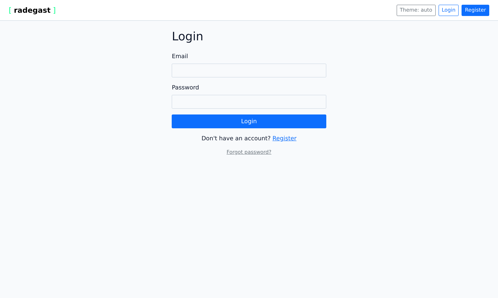
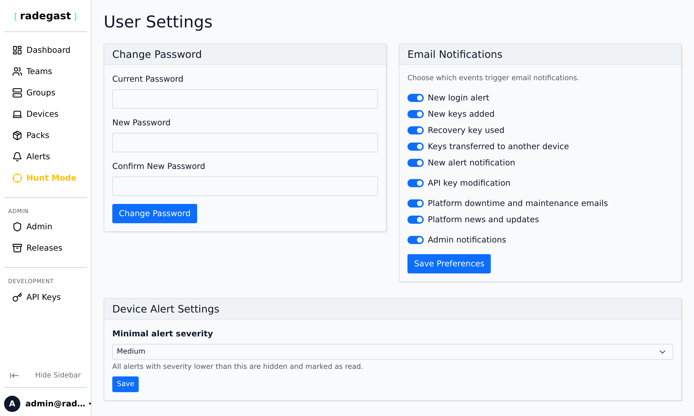

# Multi-Factor Authentication (MFA)

## Overview

Multi-Factor Authentication (MFA) provides a second layer of security for user accounts. When MFA is active, you must provide a second verification factor after entering your password. Radegast EDR supports Time-based One-Time Passwords (OTP), FIDO2 Hardware Tokens, and WebAuthn authenticators.

## Capabilities

- **Account Protection**: Prevent unauthorized logins if passwords are leaked or compromised.
- **Regulatory Compliance**: Satisfy organizational requirements for strong authentication.
- **Multiple Factors**: Register and manage multiple authentication methods on a single account.
- **Role Enforcement**: Administrators can enforce mandatory MFA levels based on user roles.

## Supported Authentication Factors

1. **OTP (One-Time Password)**: Standard time-based codes generated by mobile authenticator applications (Google Authenticator, Authy).
2. **Hardware Security Tokens**: Physical FIDO2 security keys connected through USB or NFC (such as YubiKey).
3. **WebAuthn Platform Authenticators**: Built-in biometric authenticators (Windows Hello, Touch ID, Face ID).

## Configure Multi-Factor Authentication

When an administrator requires MFA for your account, the console prompts you to configure a factor during login.

You can also configure MFA at any time in **Settings > MFA**:

### Configure OTP Authentication

1. Open **Settings > MFA**.
2. Select **Configure OTP**.
3. The console displays a QR code and secret seed key.
4. Open your mobile authenticator app and scan the QR code.
5. Save the secret key in a secure backup location.
6. Enter the current 6-digit code shown in your app into the verification box.
7. Click **Verify and Enable**.
8. The console enables OTP authentication for your account.

### Configure a Hardware Security Token

1. Insert your FIDO2 security key into a USB port.
2. In the console, go to **Settings > MFA** and click **Register Hardware Token**.
3. Follow the browser prompt and touch the gold contact or button on your security key.
4. Enter a descriptive token label (for example, `YubiKey 5C`).
5. Click **Save**.
6. The console registers the hardware token.

### Configure WebAuthn Platform Authentication

1. In the console, go to **Settings > MFA** and click **Register WebAuthn**.
2. When prompted by your operating system, complete the biometric prompt (fingerprint or facial recognition).
3. Enter a label for the device.
4. Click **Save**.

## Log In with Multi-Factor Authentication

1. Open the console login page.
2. Enter your email and password.
3. Click **Login**.
4. The console displays the MFA verification screen.
5. Authenticate using your registered method:
   - **OTP**: Enter the 6-digit code from your authenticator application.
   - **Hardware Key**: Touch your security key when prompted.
   - **WebAuthn**: Complete the biometric scan.
6. Click **Verify**. The console completes authentication and opens the dashboard.

## Manage Registered Factors

1. Open **Settings > MFA**.
2. Review your registered authentication methods.
3. To delete a factor, click the trash icon next to the factor name and confirm.

:::{caution}
Do not remove your only active authentication factor if your role requires MFA.
:::

## Reset MFA Access

If you lose access to all registered MFA factors:

1. Contact a platform administrator.
2. The administrator can reset your authentication factors from the Admin panel.
3. The reset clears all registered factors and sends a temporary password to your email.
4. Log in with the temporary password and register a new MFA factor immediately.

## Troubleshooting

### OTP Code Rejected

- **Clock Drift**: Mobile authenticator apps rely on accurate time synchronization. Make sure the clock on your mobile device is synchronized with network time.
- **Code Expired**: OTP codes change every 30 seconds. Enter the newest 6-digit code before the timer expires.

### Hardware Key Not Recognized

- **Browser Permissions**: Make sure your browser supports the WebAuthn standard.
- **USB Connection**: Disconnect and reconnect the security key. Make sure the browser has focus when you touch the sensor.

### WebAuthn Unavailable

- **Platform Compatibility**: Ensure your operating system and browser support biometric platform authenticators.
