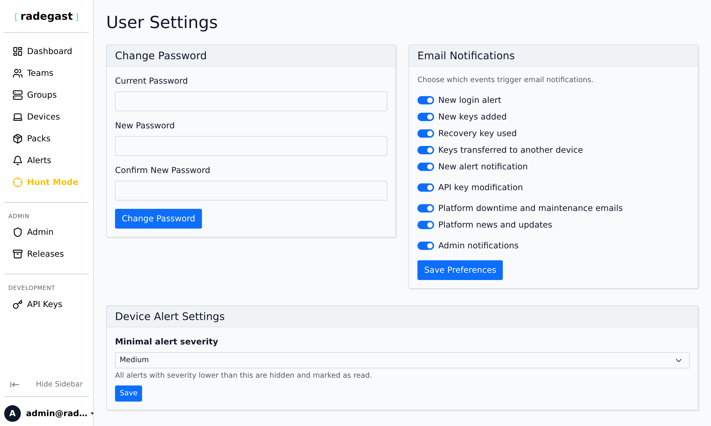

# Notifications

## Overview

Radegast EDR sends email notifications to inform you about critical security incidents and account events. You configure notification subscriptions and severity filters in your user settings.

## Notification Categories

The system supports these email notification categories:

- **New Login Alerts**: Informs you when a user logs in to your account.
- **New Encryption Keys Added**: Informs you when someone registers a key pair on your account.
- **Recovery Key Used**: Informs you when someone uses your recovery key to restore private keys.
- **Keys Transferred**: Informs you when a private key is transferred to another browser.
- **Device Security Alerts**: Informs you when monitored endpoints generate security alerts.
- **Platform Maintenance**: Informs you about planned maintenance and system downtime.
- **API Key Modifications**: Informs you when an API key is created or deleted.
- **Platform News and Releases**: Informs you about software updates and feature announcements.
- **Admin Notifications** (Administrators only): Informs administrators about agent releases and system events.

## Configure Notification Preferences



1. Log in to the Radegast Console.
2. Click your profile icon and select **Settings**.
3. Locate the **Notifications** section.
4. Toggle each notification switch ON or OFF based on your requirements.
5. For **Device Security Alerts**, set the **Minimum Severity Level**:
   - `Informational`: Receive notifications for all alert severity levels.
   - `Low`: Receive notifications for Low, Medium, High, and Critical alerts.
   - `Medium`: Receive notifications for Medium, High, and Critical alerts (default).
   - `High`: Receive notifications for High and Critical alerts only.
   - `Critical`: Receive notifications for Critical alerts only.
6. Click **Save**.

:::{important}
Alerts with a severity level below your configured threshold are automatically marked as seen and do not trigger email messages.
:::

## Email Message Contents

Notification emails include these attributes:

- **Event Type**: Name of the security or system event.
- **Timestamp**: Time of occurrence in UTC.
- **Source IP Address**: Client IP address for logins and key modifications.
- **Device Attributes**: Name and identifier of the affected endpoint.
- **Severity**: Calculated severity for detection events.
- **Direct Link**: URL link to the event in the web console.
- **Unsubscribe Link**: URL to unsubscribe from that notification category.

## Email Delivery Architecture

- **Debouncing**: The system combines high-volume alerts into batch emails to prevent inbox flooding.
- **Immediate Transmission**: Critical events (such as new account logins) send immediately.
- **Verification Requirement**: The system delivers notifications only to verified email addresses.

## Troubleshooting

### No Emails Arrive

- **Unverified Email**: Check **Settings > Profile** to make sure you verified your email address.
- **Spam Filters**: Inspect your spam or junk folder.
- **Severity Filter**: Make sure alert severities meet or exceed your configured minimum threshold.
- **Server Mail Configuration**: Verify that your administrator configured SMTP settings.

### Server Logs Display Emails but Inbox is Empty

The backend operates in development fallback mode when `RADEGAST_SMTP_HOST` is not set. In fallback mode, the backend prints email contents to stdout instead of sending them. Set `RADEGAST_SMTP_HOST` on the backend container to send real emails.

### Connect to SMTP Servers Without STARTTLS

By default, the backend requires STARTTLS to send email securely. If your internal or test SMTP server does not support STARTTLS, set this environment variable:

```ini
RADEGAST_SMTP_STARTTLS=false
```
