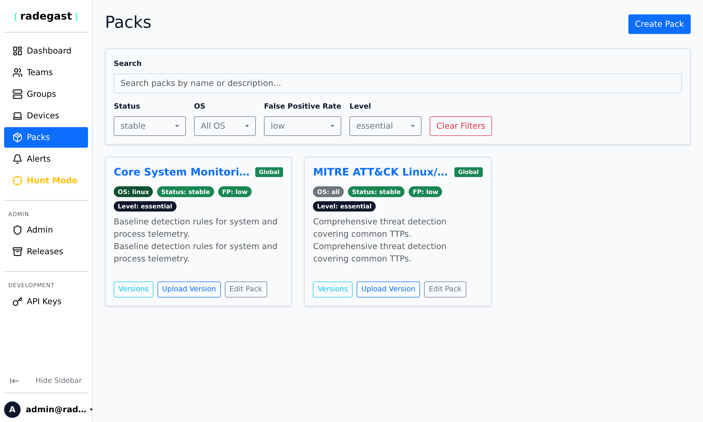
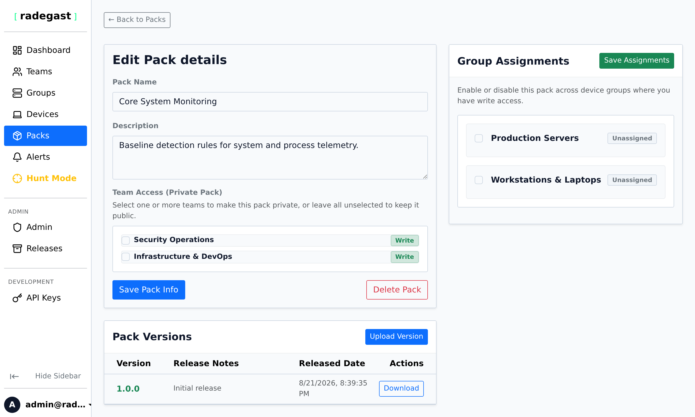

# Detection Packs

## Overview

Detection Packs contain security rules and configurations that define what the Radegast agent monitors on endpoints. Packs include detection rules, version numbers, and operating system targets. This document explains how to create, upload, distribute, and manage detection packs.

## Capabilities

- **Custom Detection Rules**: Define detection patterns for system behaviors, files, and network traffic.
- **Version Tracking**: Publish, update, and roll back versioned detection rule sets.
- **Scoped Distribution**: Share packs with specific teams, or publish global packs across the platform.
- **Multiple Formats**: Upload YAML configuration files, ZIP archives, or compiled binary rules.

## View Detection Packs

1. Log in to the Radegast Console.
2. Click **Packs** in the main navigation menu.
3. The catalog displays all detection packs that you have permission to view.

The packs table displays:
- **Pack Name**: Name of the detection pack.
- **Pack ID**: Unique identifier used in API calls and agent configurations.
- **Description**: Summary of monitored threats and detection scope.
- **Version**: Latest published version.
- **Teams**: Teams granted access to the pack.
- **Actions**: Buttons to inspect details, upload versions, or remove the pack.

### Catalog Sorting Order

The catalog sorts packs using these sequential criteria:
1. **Publication Scope**: Private (team-restricted) packs appear first, followed by Global (public) packs.
2. **Release Status**: `stable` > `testing` > `experimental` > unclassified.
3. **Expected False Positive Rate**: `low` > `medium` > `high` > null.

## Create a Detection Pack

1. Click **Create Pack** on the Packs page.
2. Complete the form fields:
   - **Pack Name**: Enter a descriptive name (for example, `Linux LOLBins Detection`).
   - **Pack ID** (Optional): Enter a unique alphanumeric identifier with hyphens or underscores. If omitted, the system generates an ID from the name.
   - **Description**: Enter details about the detection coverage.
   - **Teams** (Optional): Select teams that can access this pack. Leave blank to make the pack public.
3. Click **Create Pack**.

:::{note}
Only Admins and Maintainers can create public packs. Regular users can share packs only with teams to which they belong.
:::

## Upload Pack Content

After you create a pack, upload the detection content:

1. Select the pack from the catalog.
2. Click **Upload Version**.
3. Choose the rule file to upload:
   - **YAML files**: Text configuration files defining Sigma or event rules.
   - **ZIP archives**: Compressed archives containing multiple rule files.
   - **Binary files**: Pre-compiled detection rule engines.
4. Enter optional version release notes.
5. Click **Upload**.

The backend validates the file syntax and stores the version.

## Download Pack Content

1. Open the pack details page.
2. Locate the version in the **Versions** table.
3. Click **Download** for the desired version.
4. The browser saves the file to your local computer.

## Modify Pack Metadata

1. Open the pack details page.
2. Click **Edit**.
3. Modify the pack name, description, or assigned teams.
4. Click **Save Changes**.

## Manage Team Access

### Add a Team to a Pack

1. Open the pack details page.
2. In the **Teams** section, click **Add Team**.
3. Select the team from the dropdown list.
4. Click **Add**.

### Remove a Team from a Pack

1. Open the pack details page.
2. Locate the team in the **Teams** table.
3. Click the **Remove** button.
4. Confirm the removal.

## Delete a Detection Pack

1. Open the pack details page.
2. Click **Delete Pack**.
3. Confirm the deletion.
4. The system removes the pack metadata and all uploaded version files.

:::{caution}
Deleting a pack is permanent. Endpoints that use this pack will not receive updates.
:::

## Troubleshooting

### Cannot Create a Pack

- **Duplicate Identifier**: The specified Pack ID already exists. Choose a different ID.
- **Insufficient Permissions**: You must belong to the selected teams with pack write permissions.
- **Public Pack Restriction**: Only Admins and Maintainers can create public packs without team restrictions.

### Upload Fails Validation

- **File Format Error**: Make sure your YAML or ZIP archive complies with the required schema.
- **Corrupted Archive**: Verify that the ZIP file opens without decompression errors.
