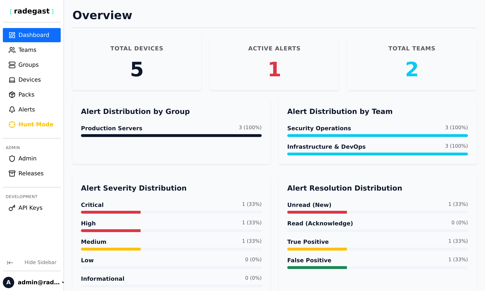

# Platform Overview

Radegast EDR is an Endpoint Detection and Response (EDR) platform designed for small teams and independent labs. Radegast EDR uses age end-to-end encryption (E2EE) to keep all log data private. The server stores only encrypted data that the server cannot read.

## Key Capabilities

- **Real-Time Threat Detection**: Monitor endpoints for suspicious processes, network connections, and system activities.
- **Centralized Console**: View and triage security alerts from all endpoints in one web dashboard.
- **Data Privacy**: The agent encrypts log data with age before transmission. The server never accesses private keys or plaintext logs.
- **Team Access Control**: Organize users into teams with role-based permissions and device group access.
- **Detection Policies**: Distribute YAML and binary detection packs across endpoints.
- **Event Filtering**: Use JSONata exclusions to filter known benign events and prevent alert fatigue.

## Architecture

Radegast EDR provides a compact architecture:

- **Built-in Database**: The backend uses an integrated SQLite database. An external database server is not required.
- **Self-Hosted Service**: Deploy the platform on a single host with Podman or Docker.
- **Standard Cryptography**: The platform uses age encryption (X25519 and ChaCha20-Poly1305).
- **Single Container**: Run the backend and web console from a single container image.

## Core Components

### Dashboard
The dashboard provides a central view of endpoint security:
- Alert distribution by severity (Critical, High, Medium, Low, Informational).
- Counts of unread and resolved alerts.
- Alert distribution by team and device group.
- Quick navigation to recent security events.

### Alerts and Logs
The alert and log triage system provides:
- **Alerts**: Prioritized security events generated by detection rules.
- **Logs**: Encrypted records of endpoint activities.
- **Triage Actions**: Mark alerts as read, assign resolution statuses, and record investigation notes.
- **Search and Filter**: Filter events by date range, severity level, device, or group.

### Devices
Monitored endpoints run the Radegast agent:
- **Enrollment**: Register new endpoints in the console.
- **Authorization Tokens**: Authenticate endpoints with unique tokens.
- **Status Monitoring**: Track agent versions, connection states, and last seen timestamps.
- **Group Assignment**: Assign endpoints to device groups to apply policies.

### Teams and Device Groups
Access control structure for operations:
- **Teams**: Groups of users with assigned permissions for devices, detection packs, and logs.
- **Device Groups**: Collections of endpoints that share configuration policies.
- **Permission Levels**: Control access to packs, invitations, administrative settings, and logs.

### Detection Packs
Detection policies for endpoints:
- **Policy Files**: Detection rules formatted as YAML or compiled binaries.
- **Version Tracking**: Manage and distribute versioned policy updates.
- **Access Scopes**: Assign packs to teams, or make packs global (Admins and Maintainers only).

### Exclusions
Filter expected benign activities:
- **Query Expressions**: Define JSONata queries to filter matching events.
- **Group Scope**: Apply exclusions to specific device groups.
- **Hard and Soft Exclusions**: Drop matching events completely or downgrade them to informational severity.

## Workflow

1. **Install Agent**: Install the Radegast agent on the endpoint.
2. **Collect Events**: The agent monitors system activity and detects policy matches.
3. **Encrypt Data**: The agent encrypts event data with the public key.
4. **Transmit Logs**: The agent sends encrypted logs to the backend.
5. **Generate Alerts**: The backend receives events and registers alerts.
6. **Send Notifications**: The backend sends email alerts based on user notification thresholds.
7. **Triage Incidents**: Users decrypt and review alerts in the web console.
8. **Take Action**: Analysts investigate and resolve alerts.

## Security Model

Radegast EDR implements multiple security controls:

- **End-to-End Encryption**: Endpoints encrypt log data before transmission. Only users with private keys can decrypt logs.
- **Multi-Factor Authentication**: Accounts support OTP, FIDO2 security keys, and WebAuthn authenticators.
- **Role-Based Permissions**: Granular permissions restrict access to devices, groups, and logs.
- **Local Key Storage**: Private encryption keys stay in browser local storage and never reach the server.

:::{note}
Extended triage features and automated process termination require Extended EDR mode.
:::

## Getting Started

To start using Radegast EDR:

1. Register an account in the console.
2. Log in and configure Multi-Factor Authentication.
3. Generate your encryption key pair.
4. Create a team and a device group.
5. Add a device and copy the authorization token.
6. Install the agent on the endpoint.
7. Review alerts on the dashboard.
