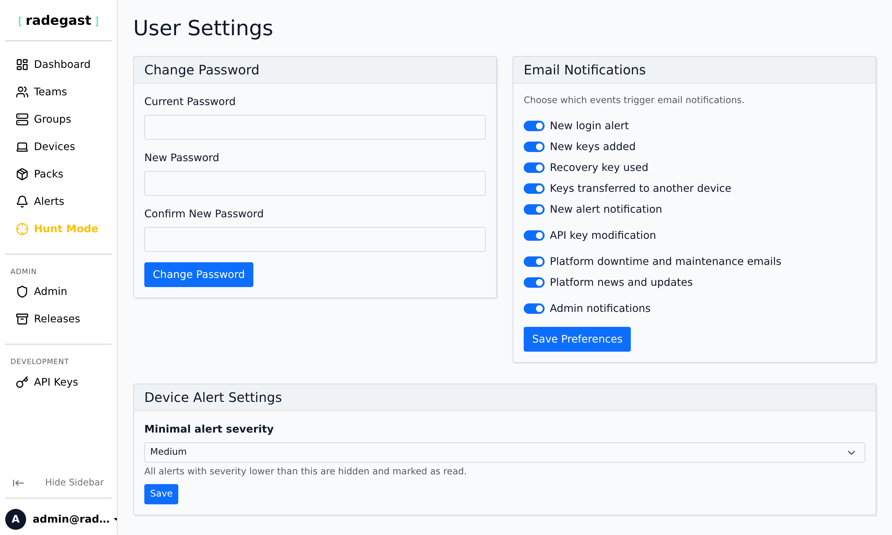

# User Settings

## Overview

The Settings page lets you configure account credentials, notification subscriptions, cryptographic keys, and platform feature modes.

## Access Settings

1. Log in to the Radegast Console.
2. Click your profile icon or email address in the navigation bar.
3. Select **Settings** from the dropdown menu.

## Settings Categories

- **Profile**: View account email and verification status.
- **Security**: Update password and manage authentication credentials.
- **Notifications**: Configure email notification thresholds.
- **Encryption Keys**: Manage age public and private key pairs.
- **Extended EDR**: Enable advanced triage, Hunt Mode, and Active Response.
- **API Keys Support**: Enable API token generation.
- **MFA**: Register and manage multi-factor authentication methods.

## Password and Account Security

### Change Your Password

1. Locate the **Security** section.
2. Enter your **Current Password**.
3. Enter your **New Password**.
4. Re-enter the new password in the **Confirm New Password** field.
5. Click **Change Password**.

:::{tip}
Use a strong, unique password generated by a password manager.
:::

## Encryption Keys Management

Radegast EDR uses age encryption to provide end-to-end encryption. The browser stores private keys locally and never transmits them to the server.

### Key Types

- **Primary Keys**: Used by your browser to decrypt telemetry logs and alert details.
- **Recovery Keys**: 256-bit AES keys used to encrypt a backup copy of your private key on the server.

### Generate a New Key Pair

1. In the **Encryption Keys** section, click **Add New Encryption Key Pair**.
2. Enter a descriptive key label (for example, `Desktop Workstation`).
3. Select the **Recovery Key** option to create an encrypted server backup.
4. Click **Generate & Register**.
5. Save the 64-character hexadecimal **Recovery Key** in a secure password manager.
6. Click **Done**.

:::{caution}
If you lose your recovery key, you cannot restore private keys after browser storage is cleared.
:::

### Key Transfer Between Browsers

1. On the source device, open **Settings > Encryption Keys**.
2. Click **Transfer to Another Browser**.
3. Note the ephemeral transfer token.
4. On the destination device, open **Keys > Transfer**.
5. Enter the transfer token and click **Import Key**.

## Extended EDR Mode

Extended EDR mode unlocks advanced endpoint security controls:

- **Standard Mode** (Default): Alerts remain active until marked as seen. Resolution statuses are optional.
- **Extended EDR Mode**:
  - Alerts remain active until you assign an explicit triage resolution (True Positive, False Positive).
  - Unlocks **Active Response** automated process termination.
  - Unlocks **Prevention Allowlists** in device group settings.
  - Enables **Hunt Mode** for fleet-wide telemetry searches.

### Enable Extended EDR Mode

1. Locate the **Extended EDR** section.
2. Toggle **Enable Extended EDR Mode** to ON.
3. Click **Save**.

:::{note}
Extended EDR mode is a per-user setting. Changing this setting does not affect other users.
:::

## API Keys Support

API keys let external automation scripts interact with the REST API:

1. Locate the **API Keys Support** section.
2. Toggle **Enable API Keys Support** to ON.
3. Click **Save**.
4. Go to the [API Keys Guide](api-keys.md) to generate scoped tokens.

## Multi-Factor Authentication

To configure OTP, hardware tokens, or WebAuthn platform authenticators, refer to the [MFA Guide](mfa.md).

## Troubleshooting

### Settings Do Not Save

- **Session Expiration**: Your authentication session expired. Log in again and retry.
- **Role Permissions**: Some settings require administrator privileges. Contact an administrator to adjust your permissions.
