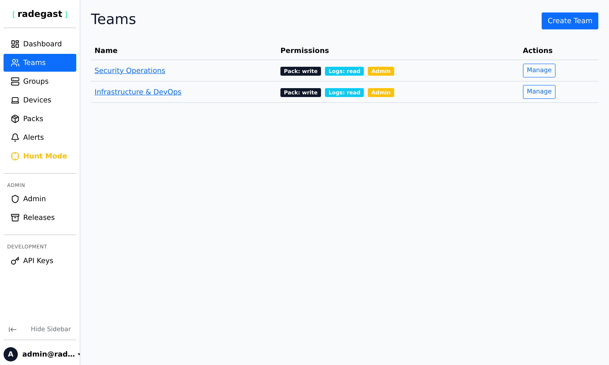
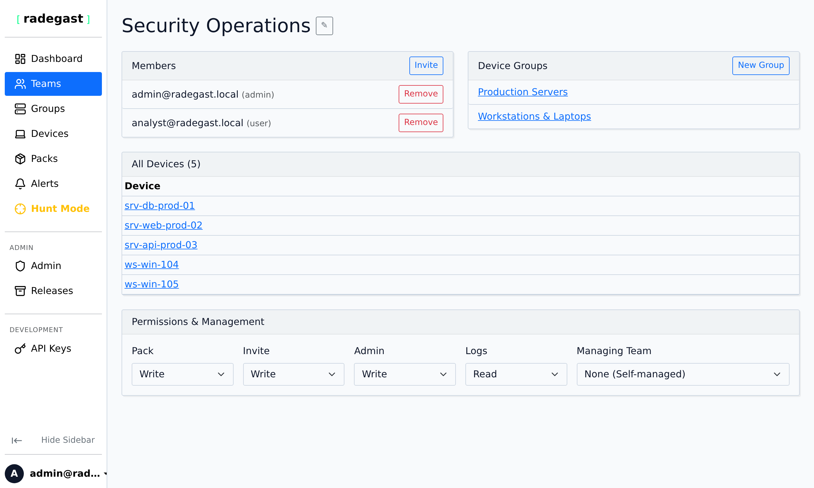

# Teams Management

## Overview

Teams provide the primary access control structure in Radegast EDR. Teams organize users and control access to endpoints, detection packs, and encrypted logs. Each team defines permissions for detection packs, member invitations, administrative settings, and log inspection.

## Capabilities

- **Access Delegation**: Control which users can inspect endpoints and triage security alerts.
- **Granular Permissions**: Set independent permissions for packs, invites, admin tasks, and logs.
- **Hierarchical Governance**: Model organizational structures with managing team relationships.
- **Team Collaboration**: Share detection policies and incident response workflows among team members.

## View Teams

1. Log in to the Radegast Console.
2. Click **Teams** in the main navigation menu.
3. The page displays all teams that you have permission to view.



The teams table shows:
- **Team Name**: Name of the team.
- **Permissions Summary**: Configured permissions for packs, invites, administration, and logs.
- **Member Count**: Number of assigned users.
- **Device Count**: Number of devices accessible through the team's groups.
- **Space Used**: Total storage consumed by devices for root teams with administrative permissions.
- **Actions**: Buttons to inspect details, modify settings, or remove the team.

## Create a New Team

1. Click **Create Team** on the Teams page.
2. Complete the form:
   - **Team Name**: Enter a descriptive name (for example, `Security Operations Center`).
   - **Pack Permission**:
     - `None`: Members cannot view or manage detection packs.
     - `Read`: Members can view packs.
     - `Write`: Members can create, modify, and delete packs.
   - **Invite Permission**:
     - `None`: Only administrators can invite members.
     - `Write`: Team members can invite users to the team.
   - **Admin Permission**:
     - `None`: No administrative rights over the team.
     - `Write`: Full administrative control over team settings and members.
   - **Logs Permission**:
     - `None`: Members cannot view logs or alerts.
     - `Read`: Members can view and triage logs and alerts from assigned device groups.
   - **Managing Team** (Optional): Select a parent team to manage this team.
3. Click **Create Team**.

:::{note}
If you set Admin permission to `None`, you must select a managing team with `admin=write` permissions.
:::

## View Team Details

1. Click a team name in the list.
2. The details page displays:
   - Team identifier and creation timestamp.
   - **Permissions**: Status of pack, invite, admin, and log permissions.
   - **Managing Team**: Parent team in the management hierarchy.
   - **Members**: Registered users in the team.
   - **Device Groups**: Groups owned by the team.
   - **Detection Packs**: Packs accessible to the team.



## Manage Team Members

### Add a Member

1. Open the team details page.
2. Locate the **Members** section and click **Add Member**.
3. Enter the email address of the registered user.
4. Select the user from the list.
5. Click **Add**.

:::{note}
The user must have an active Radegast account before you can add them to a team.
:::

### Remove a Member

1. Open the team details page.
2. Locate the user in the **Members** table.
3. Click the **Remove** button.
4. Confirm the removal.

## Edit Team Settings

1. Open the team details page.
2. Click **Edit Team**.
3. Modify the team name, permissions, or managing team.
4. Click **Save Changes**.

## Team Hierarchy

You can organize teams into a management hierarchy:

- **Parent (Managing) Team**: An administrative team that governs child teams.
- **Child (Managed) Team**: A team governed by a parent team.

```
Security Operations HQ (admin=write)
├── Incident Response (managing_team=Security Operations HQ)
│   └── Junior Analysts (managing_team=Incident Response)
└── Threat Intelligence (managing_team=Security Operations HQ)
```

In this hierarchy, administrators of the parent team can manage child team settings, members, and resources.

## Delete a Team

1. Open the team details page.
2. Click **Delete Team**.
3. Confirm the deletion.
4. The system removes the team and associated memberships.

:::{caution}
Deleting a team is permanent. You cannot delete a team that serves as the managing team for other teams. You must reassign or delete child teams first.
:::

## Troubleshooting

### Cannot Create a Team

- **Insufficient Permissions**: You must be an administrator or hold administrative permissions on a team.
- **Missing Managing Team**: If you set `admin=None`, you must choose a valid managing team.

### Cannot Add a Member

- **Account Not Found**: The user must complete registration and email verification before you can add them.
- **Existing Member**: The user is already a member of the team.

### Cannot Delete a Team

- **Child Dependencies**: Reassign or remove all child teams that specify this team as their managing team.
